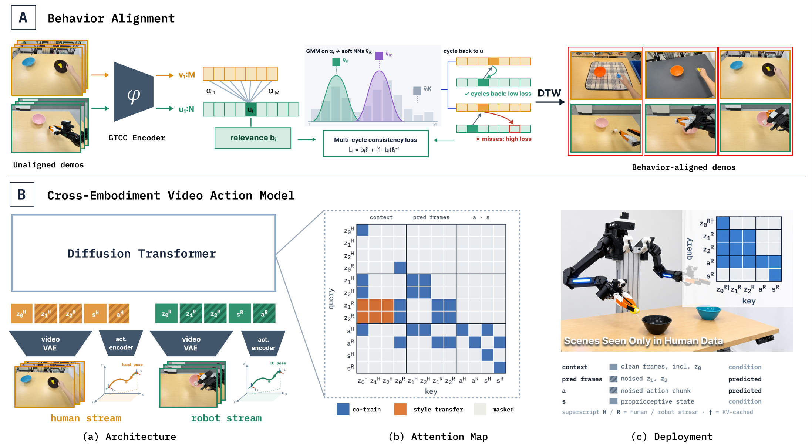
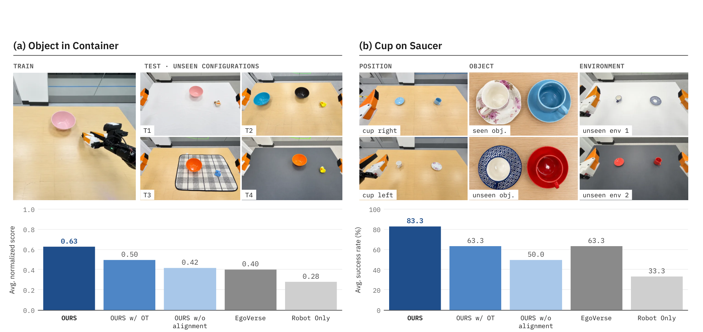

# BATCH：先对齐行为阶段，再让人类数据帮助机器人

> 简短说明：BATCH 先学人和机器人执行同一任务时的时间对应，再用对齐片段进行视频—动作联合训练和人到机器人的视频风格迁移。两项真机任务显示对齐有用；其中 0.63 是归一化过程得分，83.3% 才是另一任务的完整成功率。测试场景在机器人数据中未见，但已出现在人类训练数据中。

## 1. 问题：同一任务不等于相同时间进度

人比机器人快、动作顺序和停顿不同，还可能夹杂无关片段。把两类数据直接混合，模型可能只学会区分本体，未学会哪些行为阶段可以互相帮助。（§1、3.1）

行为对齐不是把手位置简单映射成夹爪位置，而是找到“正接近物体”“已抓住”“正在放下”等同等进度的帧。对齐编码器用视频上下文学习，再用动态时间规整（DTW）产生显式对应；这些对应随后约束训练样本与跨域视频目标。

这篇连接人类数据和世界动作模型，但研究设定是**单任务训练**、两个操作任务；去掉文本条件，不是一个听任意指令的通用 VLA。

## 2. 数据与坐标：人类 OOD 不等于全系统未见

机器人预训练建立可执行动作，人类数据补充对象和场景，配对阶段仍需要机器人示范。理解每个阶段看过什么，才能解释其泛化结论。（App.A、B，pp.14–16）

| 阶段 | 来源与表示 | 规模 / 权限 |
|---|---|---|
| 对齐特征 | 冻结 ImageNet ResNet-50；因果邻帧窗口、两层 3D 卷积、MLP 输出 128D | GTCC 自监督学时间对应；人工 phase 标签只用于评测 |
| 机器人采集 | 双 ARX5，人形肩部支架、Aria 头视角、Logitech 腕视角 | Object in Container 90 demos；Cup on Saucer 270 demos |
| 人类采集 | Aria Gen 1 RGB，MPS 手位姿 | 各场景分别 5 / 8 demos；不是总共只用 5 / 8 条 |
| 状态/动作 | 机器人每臂位置3+四元数4+夹爪1；人类每手7维 | 人类夹爪维补零，**从人类动作 loss 排除** |
| 视频动作骨干 | Wan2.1-I2V-14B 的前8个 Transformer blocks、VAE、CLIP ViT-H/14 | 不是完整 14B 所有层，也不是从随机初始化训练 |

位姿先用标定外参转换到头相机系，再相对该臂窗口首帧表示 `T̃_t=T₀⁻¹T_t`；夹爪仍为绝对宽度，各本体分别用 1/99 分位归一化。相同布局不代表手和夹爪物理可一一互换。

30 fps 录像每6帧取一幅，共9幅、约1.6 s；动作10 Hz、16步。机器人有头/腕图，人类只有头图，缺失腕区域补零。部署 OOD 对象/背景已通过人类 demonstrations 进入微调；更准确说法是**跨本体转移到机器人数据未覆盖的条件**，不是所有训练来源均未见。

## 3. 机制：对齐、两类损失与机器人单流部署

先构建时间对应，再分清哪一种训练允许跨流看信息。否则容易误以为联合训练总在直接融合人机 token，或风格迁移同时制造了机器人动作标签。（Fig.2，§3.1–3.2）

**GTCC**：机器人帧 u 对人类各帧 v 的软匹配权重与 `exp(−‖u−v‖²/τ)` 成比例。因为重复任务可能有多个合理匹配，单个平均向量会落到不存在的阶段；GTCC 用时间轴上的高斯混合保留多个候选，再让每个候选循环匹配回原来的机器人时刻。额外 relevance 权重处理无对应片段。

**DTW**：以特征距离为代价，找覆盖整个机器人窗口的人类子序列，允许多对一时间扭曲。每个窗口保存候选及路径；Object in Container 取 top-5、Cup on Saucer top-1，训练时均匀采一个，按路径索引人类图像、状态和动作。

**教学微例**：机器人四帧的进度是“接近、接近、抓起、放下”，人类三帧是“接近、抓起、放下”。刚性按索引会把第二个“接近”配到“抓起”；DTW 可用对应 `(1→1,2→1,3→2,4→3)`。这个例子解释速度差，不意味着 DTW 能任意交换动作顺序。

机器人预训练 20000 steps，随后微调 1000 steps，以各 0.5 概率交替两种目标：

- **Joint co-training**：人机各预测自己的视频和动作；共享权重，但 self-attention、CLIP cross-attention 和位置索引相互隔离，人类只经共享参数影响机器人路径。
- **Style transfer**：给完整干净人类视频，预测对应机器人未来视频。遮掉机器人 conditioning latent，并把两边 action/state register 置零，避免绕过人类信息；机器人仍保留初始头/腕 CLIP 的粗场景条件。**此目标只监督机器人视频，不监督动作。**

Flow matching 使用 `xσ=(1−σ)x₀+σε`，目标速度 `ε−x₀`。例如教学标量 `x₀=2, ε=−1, σ=0.4` 得到 `xσ=0.8`、目标 `−3`；这个噪声轴并非真实任务时间。

部署仅机器人流，每次生成16动作，10 Hz 同步执行前8步后重规划。UniPC 标称16 solver steps，其中8步真正调用 Transformer，其余复用速度；动作降到 σ=0，视频只到 σ=0.25。5090 上单臂 0.35 s、双臂 0.42 s。8动作的执行窗口为0.8 s，不能把10 Hz动作发送频率当作10 Hz完整闭环重规划。

## 4. 证据：对齐质量与任务表现是两组实验

先检查对应帧是否同阶段，再检查机器人是否真的做得更好。对齐 overlap、任务过程得分与完整成功率不可互换。（Table1、Fig.4/7，§4、App.D）

### 仿真证据协议

| 字段 | 核验结果 |
|---|---|
| Benchmark / 任务 / split / 次数 | 本文未报告仿真策略评测；不补仿真成功率。 |
| 证据 | §4，PDF pp.6–9；实验由离线对齐与两项真实操作组成。 |

### ID / OOD 的维度

| 变化 | 训练暴露与测试 | ID / OOD 与可比性 |
|---|---|---|
| 对象、背景、干扰物 | Object 四个机器人未见配置；人类微调数据覆盖这些条件 | 策略 ID 原始分未逐场景给出；OOD 为0.76/0.47/0.49/0.78归一分；不计算SR下降。Fig.7，p.18 |
| 杯组与桌布 | Cup 三组分别未见杯组、白/灰桌布混合杯组；每组10次 | OOD 9/10、8/10、8/10；匹配ID计数未报告。App.D |
| 语言、全新技能 | 单任务且移除文本条件 | 未报告，不称语言泛化。§3.2 |

### 真机协议与失败边界

| 字段 | 核验结果 |
|---|---|
| 机器人 / 观测 / 动作 | ARX5单/双臂；头+腕RGB、本体状态；相对末端位姿与夹爪；16步预测执行8步，10 Hz同步执行。App.A/B |
| 次数 / 判定 | Object 4×5次，每次60 s累计技能分；Cup 3×10次完整成功，详细结果见下表。App.D |
| 延迟 / 完成时间 / 干预 | 推理0.35/0.42 s；Cup完成时间、逐次人工介入和安全停止数未报告。App.B.2.4 |
| 失败 / 适配 | 有机器人预训练与人类配对微调；测试失败未按滑落、碰撞等分类计数。Fig.4 |

| 对齐方法 | Object OOD overlap / progress error | Cup OOD overlap / progress error |
|---|---|---|
| GTCC + DTW | 57.8% / .098 | 71.7% / .075 |
| 去掉 DTW | 24.7% / .231 | 70.8% / .085 |
| DINOv3 + DTW | 42.3% / .156 | 22.1% / .433 |
| GTCC + 绝对动作 + DTW | 54.6% / .106 | 76.5% / .073 |

DTW 对重复循环的 Object 影响大；Cup 上加入绝对位姿反而最好，因此“只用视觉总最好”不成立。每场景10条机器人示范、每 episode 400个窗口与全部候选配对，窗口高度相关，不能把所有帧当独立二项试验给窄置信区间。

| 方法 | Object：20次、各60 s，归一化过程分数 | Cup：30次完整成功 |
|---|---|---|
| BATCH | 0.63 | 25/30，{{ci:25/30}} |
| 用 OT 替换 style transfer | 0.50 | 19/30，{{ci:19/30}} |
| 去行为对齐 | 0.42 | 15/30，{{ci:15/30}} |
| EgoVerse 式 co-training | 0.40 | 19/30，{{ci:19/30}} |
| 机器人预训练单独部署 | 0.28 | 10/30，{{ci:10/30}} |

Cup 计数由 Fig.4 百分比与30次协议换算；附录三场景分别9/10、8/10、8/10，吻合25/30。区间是阅读者计算的95% Wilson，未包含不同场景和训练随机性的额外不确定性。OOD 具体区分：T1未见杯组；T2白桌布混合见/未见杯组；T3灰桌布中见/未见各5次。Object四场景各5次，完成一个技能得1分，以域内平均分（文中例55分）归一；**0.63不能写成63%任务成功，也不能推算成功次数**。

摘要“平均提升45%/138%”混合两个不同指标的相对增幅，不能理解为共同成功率增加45/138个百分点。更清楚的是分别汇报 0.40→0.63、19/30→25/30。

**仿真**：这份工作没有对应仿真策略成功率主实验。**ID/OOD下降**：有对齐ID/OOD数据，但机器人策略只以归一化域内参照或OOD测试呈现，不能补造逐场景策略ID→OOD下降表。

## 5. 可迁移的想法与边界

BATCH 最值得借用的是让时间对应显式参与训练，而不仅把人类样本数量加大。它仍依赖人机共享行为顺序、额外人类示范和目标任务机器人数据。（§4.2 limitation）

对齐错了，style-transfer 就接收到错监督；策略顺序根本不同，DTW 的单调路径也难解决。两任务、小规模真机测试不足以说明对任意人类视频或人形接触技能均有效。模型实验还同时包含额外微调、数据和不同目标，不宜将所有收益归因于单个模块。

[推断] 下一步可固定人类数据量和优化步数，按人工抽检的对应误差分桶，比较下游收益何时转为负；加入故意错配与跨阶段交换，测模型是否真正依赖行为对应。对 WB-WAM，可先在人类/机器人共有的接触阶段尝试对齐，但仍需独立检查全身动力学与接触力，不应仅凭视觉阶段一致假定动作可迁移。

### 一周实验草案与口述版

[推断] 一周内可做的最小验证：先固定人机数据与训练预算，抽检20组DTW对应；再做正确/随机/错阶段三组配对的小规模训练；最后在同一杯碟场景按相同重置协议重复测试，记录完整成功与误配率关系。这是复现实验建议，尚未执行。

**一分钟口述**：BATCH用时间对应约束人机数据共享。GTCC找行为特征，DTW对齐快慢，视频风格迁移促进跨域知识转移。真机杯碟25/30，但测试条件已被人类数据覆盖。

## 原文与阅读范围

- [BATCH，arXiv 2611.10148v1](https://arxiv.org/abs/2611.10148v1)，2026-11-06；[固定 PDF](https://arxiv.org/pdf/2611.10148v1)。已核读20页，包括附录A–D、图8/9对齐示例、图表及声明。
- [作者项目](https://batch-embodiment.github.io/)；[H2R](https://scaling-h2r-corl.github.io/) 列为 Oral。所有数值绑定上述版本；公式微例、区间与后续研究建议为阅读者补充。
