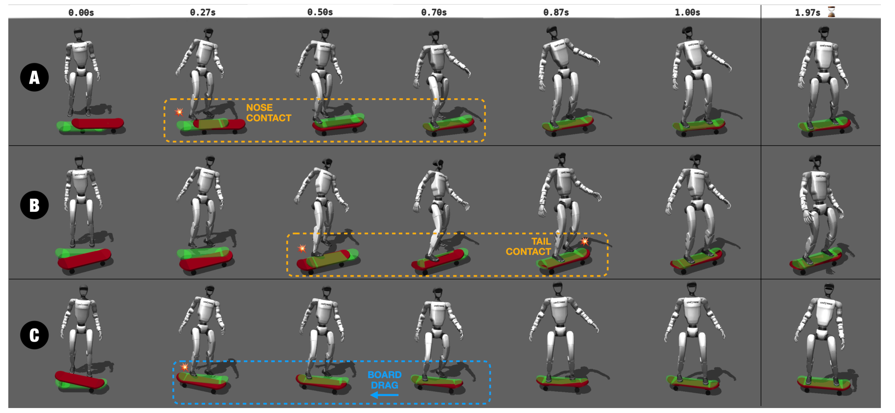

# Blind Dexterity：把关节跟踪偏差当作粗粒度触觉

> 简短说明：在顺应 PD 控制下，机器人“命令关节到哪里”和“关节实际到了哪里”的差异会携带接触信息。Blind Dexterity 用短本体状态历史学会找球、摸索滑板和提箱；操作任务仍有 IMU，只有步行消融去掉 IMU。定量成功率全部来自仿真，真机证明可迁移性，尚不证明可靠性。

## 1. 问题：没有外部视觉，还剩哪些信息

作者研究的是一个 POMDP：物体位姿不可直接观测，机器人需要通过动作创造可识别的接触。重点不在新增传感器，而在已有位置伺服器留下的动态响应。（§I–III，pp.1–2）

“Pure proprioception”包括关节编码器和机载 IMU；“encoder-only”专指移除 IMU 的实验。所有操作任务均不用摄像头、外部标记、F/T 或触觉皮肤，却仍借助已知任务与受限物体分布。不能将它描述为对任意陌生物体的盲操作。

为什么直接蒸馏看得见物体的教师可能失败？教师知道球在哪里，直接落脚；学生还没接触时，各种球位置产生相似观测，模仿容易变成“总在中间落脚”。从头用任务奖励学习的盲策略反而能发现扫动、触碰和拖拽，主动消除歧义。

## 2. 数据、监督与部署权限

这项工作没有用人类演示构建通用模型，而是在仿真里逐任务训练策略。要区分 actor 真正看见的信号、critic 的特权信息，以及只用于分析的估计器。（§IV，p.3）

| 组件 | 输入与监督 | 部署时角色 |
|---|---|---|
| Actor MLP | 关节角/速度、上一动作；操作任务另含重力投影与角速度；PPO 任务奖励 | 输出目标关节位置，50 Hz |
| Critic | Actor 输入加物体位姿/速度等仿真真值 | 只参与训练，不给部署 actor 泄露物体状态 |
| 辅助状态估计器 SE | 同样的短历史，L2 回归仿真物体状态，目标逐维标准化 | 默认 -SE 只诊断；+SE 才把上一时刻估计反馈给策略 |
| 蒸馏基线 | 用 DAgger 模仿特权教师 | 同为盲输入，但训练目标与从头 RL 不同 |

Actor/Critic 为 1024–512–256 的 ELU MLP，SE 为 256–256–256–128；SE 有独立优化器，损失梯度不流入策略。物体操作用 5 步、标称 0.1 s 历史；步行只用当前步。Isaac Sim 物理步长 0.005 s、动作降采样 4；4096 并行环境，步行/足球 5000、箱子 6000、滑板 8000 次 PPO 迭代。随机化质量、摩擦与电机强度以减小 sim-to-real 差异。

## 3. 机制：顺应让接触可观测，动作让观测更有用

单帧关节读数不足以唯一还原物体；命令历史提供了参考，顺应使外力表现为跟踪残差，而连续试探让残差随不同接触变化。（Eq.1–2，§IV-B/C）

论文动作映射为 `q_des = q_default + 0.25a`，上一目标与当前关节之差为 `e = 0.25a_previous − q_relative`，PD 力矩近似 `τ = Kp·e − Kd·q̇`。这只是粗粒度关节负载代理：相同残差也可能来自惯性、模型误差或不同接触位置，不能直接当作准确的表面接触力。

**教学微例**：上一动作值 0.4 对应目标偏移 0.10 rad；实际偏移为 0.07 rad，则残差 0.03 rad。若假设 `Kp=40 N·m/rad` 且速度近零，弹性项约 1.2 N·m。保持相同外部负载而减小刚度，残差会增大，接触线索更明显；但也可能损失支撑能力。这里数值是解释公式的示例，不是论文标称增益。

提箱的 +VS 额外预测 `α = sigmoid(a_α)`，将 PD 输出按每关节 α 缩放；原式把比例项和阻尼项都放在括号内。它允许搜索时软、插入和提升时更硬。并非给所有任务加入一个精确力传感器。

看图时按时间读：未接触时绿色趋近初始分布均值；触及鼻端/尾端后改善长轴位置估计；拖动产生方向约束，进一步改善 yaw。它支持“接触后状态可解码”的观察；可视化本身不能证明策略内部使用了完全相同的表示。

## 4. 证据：仿真随机种子与真机演示分开

核心比较是相同任务下的特权策略、蒸馏学生和两种盲 RL 策略；不要只挑最好种子，也不要把仿真表格搬到真机介绍中。（Tables I–IV，pp.4–7）

### 仿真证据协议

| 字段 | 核验结果 |
|---|---|
| 环境 / 任务 / split | Isaac Sim+RSL-RL；步行、足球、滑板、提箱逐任务训练；质量/摩擦/电机随机化。§IV |
| 观测 / 动作 / 控制 | 关节角速度+上一动作，操作另含IMU；5步历史；目标关节位置50 Hz，物理200 Hz；箱子可变增益。 |
| trials / seeds | 操作每策略4096仿真episodes；足球/滑板/步行表5 seeds；箱子表仅注明over seeds，数量未明列。 |
| horizon / 判定 | 足球6 s、接触累计>1 s；滑板12 s、双脚上板≥2 s；箱子8 s，接触把手并抬离；跌倒、越界等终止。§V |

### ID / OOD 的维度

| 变化 | 原文覆盖 | ID / OOD 与可比性 |
|---|---|---|
| 位置 / yaw / 箱尺寸 | 在定义的训练reset分布内随机化 | 不能解释成严格未见对象OOD；匹配ID→OOD降幅未报告。 |
| 传感器 | 步行移除IMU与上一动作后重新训练 | 是观测消融，非同策略突然传感器失效测试。Table I |
| 真实动力学 | 仿真策略到G1 | 有定性迁移，缺固定次数真实评测；不能计算SR保留率。§VI |

### 真机协议与失败边界

| 字段 | 核验结果 |
|---|---|
| 设备 / 观测 | Unitree G1，提箱用塑料矩形手；无外部视觉/FT/触觉，操作仍用IMU。§I–III |
| 任务 / 次数 / 成功 | 四类行为有代表性片段；次数、完整成功数、完成时间未报告。 |
| 适配 / 干预 / 安全 | 仿真域随机化后部署；固定人工干预与安全停止统计未报告。 |
| 失败边界 | 补充视频含失败，正文没有分类计数；PD/摩擦/顺应误差会改变接触残差。§VI |

| 仿真任务与成功条件 | 特权 | 蒸馏 | Blind -SE | Blind +SE |
|---|---|---|---|---|
| 足球：6 s 内累计脚球接触 >1 s | 99.8±0.1% | 31.2±33.3% | 92.9±1.2% | 86.5±22.3% |
| 滑板：双脚同时上板 ≥2 s | 28.1±39.1% | 8.2±6.3% | 88.2±1.4% | 89.7±1.6% |

上两表为 5 个独立训练种子的均值±标准差；每个操作策略评测使用 4096 个独立仿真 episodes。滑板特权策略最好种子 95.9%，均值却极不稳定；作者把它视为诊断基线，不作为性能上界。足球 +SE 最好种子为 99.3%，却不能掩盖均值和方差较差。

提箱固定刚度 -SE 为 83.5±5.3%，加入可变刚度为 88.3±1.7%；对应 tipping 从 22.5±2.8% 降至 18.8±3.1%。+VS+SE 为 85.1±8.3%、tipping 17.9±4.2%，并没有稳定提高平均成功率。表中 success 与 tipping 不是互补事件，不应自行用 `1−tipping` 重建成功率。SE 的标准化混合状态误差也不是厘米单位。

步行在随机冲击下，有 IMU+上一动作的存活率 96.1±0.5%；无 IMU 但保留上一动作 90.4±1.1%；再去上一动作为 89.1±1.1%，速度跟踪误差逐步增大（Table I，5 seeds）。因此 encoder-only 可行，不等于删掉 IMU 不损失性能。

**分布边界**：足球位置在 0.3×0.4 m 内；滑板在 0.2×0.5 m、yaw ±22.5°；箱子在 0.2×0.2 m、yaw ±45°，另随机高度/质量/桌高。这是任务内随机分布，不是未见物体类别的严格 OOD。估计器明确假设训练时的物体家族。

**真机**：G1 每项任务有策略迁移和代表性失败视频，但作者明确说明未按固定协议采集试验，硬件结果只证明 transfer feasibility（p.8）。没有真实成功次数，不能给 Wilson 区间；也不能把 92.9% 说成真机接球成功率。

## 5. 与人形部署和 Memory 的连接

这篇论文提供一个值得认真比较的本体感知基线：视觉失效时，机器人已有的伺服信息可能仍有用；它没有证明触觉皮肤或视觉可以普遍移除。（§VI）

作者指出接触位置分辨率低、多种接触会产生相似偏差；PD 动力学、摩擦与顺应的 sim-to-real 错配会破坏感知通道。固定短窗口无法积累相隔很远的接触，MSE 点估计又会把多峰不确定性平均掉。

[推断] 与 Gated Memory Policy 的自然连接，是把跨多次触碰的历史按需保存，但首先应比较固定短窗口、长窗口、门控记忆，并对控制延迟和增益漂移做独立消融。若仅增加历史而不保留历史命令与增益，残差的物理含义可能反而不清楚。真正部署还需要固定次数的对象位置/几何变化测试与跌倒、误接触统计。

### 一周实验草案与口述版

[推断] 一周内可做的最小验证：先在足球仿真复现含/不含上一动作；固定奖励与预算，再扫描PD增益和延迟；最后设计固定次数的G1小范围接触测试，先核对残差是否仍可解码，再测成功与跌倒。这是复现实验建议，尚未执行。

**一分钟口述**：关节命令与编码器读数的偏差能携带粗粒度接触信息。盲RL学会主动摸索，辅助估计器可验证状态变得可解码；这不等于通用触觉，也还没有真机可靠性统计。

## 原文与阅读范围

- [Blind Dexterity，arXiv 2608.29487v1](https://arxiv.org/abs/2608.29487v1)，2026-08-30；[固定 PDF](https://arxiv.org/pdf/2608.29487v1)。已核读全部 9 页、表格、图注与参考文献；该文件没有另列附录。
- [作者项目](https://aditya.bhatts.org/BlindDexterity/)；[Beneath the Policy](https://beneath-the-policy.github.io/) 列为 Oral Spotlight。
