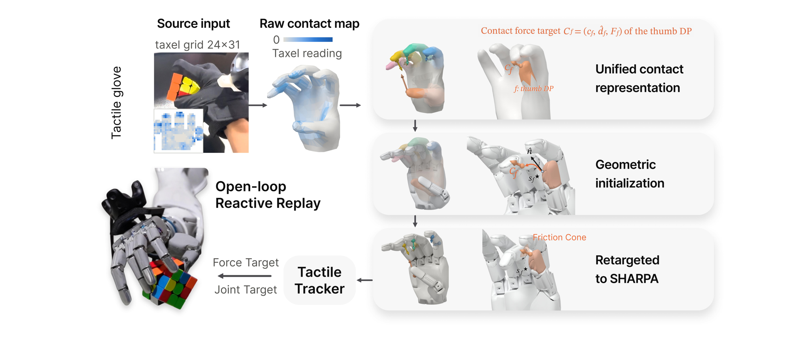
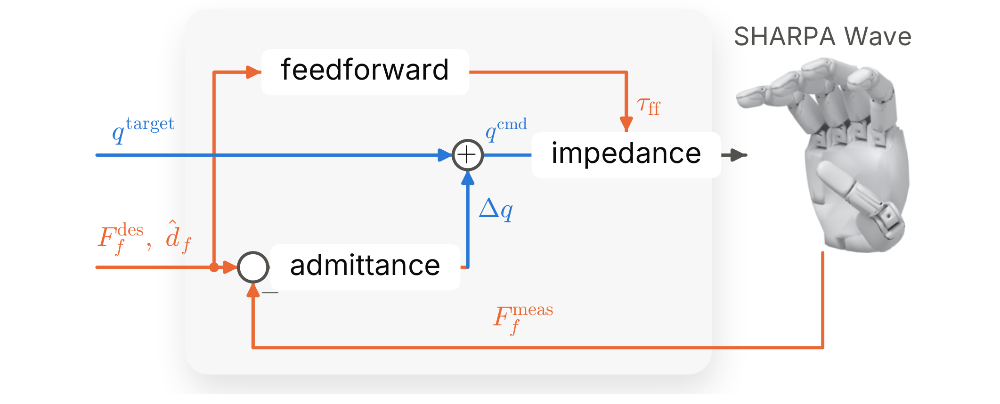

# CARD：迁移接触目标，而不只复制手指姿态

> 简短说明：CARD 将人类演示转换成手部表面上的接触点、推动方向与力目标，再优化机器人手姿态，并用触觉控制器维持接触。它可以在没有物体网格的路径上工作，但部分动捕实验与 CARD-physics 使用物体模型；所谓“开环”仍包含局部触觉反馈。接触帧比例不是完整任务成功率。

## 1. 问题：几毫米偏差为什么足以毁掉重定向

人手与机器人手的长度、关节和接触面不同。复制关键点或关节角可能看起来很像，却让手指悬空、从物体上滑过或过度挤压。CARD 把抓握的物理意图拆成要碰哪里、沿哪里推、用多大力。（§1–3）

输出有两条：关节轨迹与每个手指的接触力目标。前者给大体运动，后者交给执行端跟踪。本文重点是演示重定向与轨迹回放，没有学习一个遇到任意扰动都能重新规划的视觉策略。

请区分这篇 Cunxi Dai 等人的 **CARD，2610.36539**，与参考文献中另一篇同样使用 contact-anchored retargeting 名称的 **2609.24093**；它们是不同论文。

## 2. 数据血缘：接触标签、力值和物体几何并不等价

不同输入最终都变成 MANO 网格与语义接触目标，但观测和估计的可信度不同。尤其视频模型预测的是接触，绝不是直接测到真实接触力。（§3.1–3.2、App.A/B/H）

| 来源/组件 | 输入与生成方式 | 需要保留的限定 |
|---|---|---|
| 手机视频，20 clips | HaWoR 世界系手轨迹、Vid-HACO 每顶点接触，另用现成分割/尺度模型 | 视觉接触是推断；力由整段 grasp-balance 合成 |
| 触觉手套，18 clips | 744 taxels 注册到个性化 MANO，腕部 VIVE 追踪 | 有测量压力，仍需聚合为每区域目标 |
| 动捕，48 clips | OptiTrack 配同款手套与物体追踪 | 主文/App.A 写压力来源，App.H/Table8 却把该组标为 **proximity contact**；此版本口径需确认 |
| GRAB，100 clips | 原生手/物体几何的接近标签 | 力不是测量；默认 CARD 用伪物体，真网格用于穿透评分 |
| Vid-HACO 训练 | 12 数据集，1,553,353 train /172,873 val 帧；每集留10% | 71%来自 HOT3D 与 ARCTIC 外部视角；不能用随机留出代替完全未见数据集 |
| Vid-HACO OOD | HRDexDB：434视频、94物体、111.9k帧，未参与训练 | 标签仍以手与表面10 mm距离为规则 |

Vid-HACO 用结束于当前帧的8帧手 crop，V-JEPA 2.1 ViT-L 加 DPT、顶点与整帧接触双头，共411M参数。保留无接触帧训练，有助于避免“永远在接触”的假阳性；顶点概率阈值0.52。

对每个区域，压力或二值权重先在表面2D坐标聚合质心，再平滑并映回手面，方向取接触顶点法线的加权平均。视频/GRAB 用整段净 wrench 趋零的平衡过程合成平滑力；缺少物体质量与动力学，不应称真实力识别。

## 3. 机制：接触优化与触觉执行各做一半

先让机器人接触面接近人类目标，再让执行器真的产生所需作用力；几何上的接近不能替代实际受力。（Fig.2、Eq.1–4）

每个语义区域 f 的目标是 `C_f=(c_f,d̂_f,F_f)`：位置、单位推向和非负力。目标函数包含接触、自由手指姿态、时间平滑、碰撞四组；在关节与速度限制下优化腕部6DoF和手指关节。SHARPA是22关节手，不包含腕位姿的6维。

接触项同时要求距离小、法线与推向一致、接触点在手指表面上少滑动；力大者优先权更高，`ρ=1+0.5 F/Fmax`，而不是把力直接当关节位置。自由手指仍参考人类姿态，避免只顾接触指而让其余手指失控。

**公式微例**：方向代价为 `λr²(1−cos θ)`，论文 `λ=2,r=10 mm`。若θ=30°，代价约 `200×0.134=26.8 mm²`，相当于约5.2 mm的位置残差平方。这说明为什么只追位置会得到方向不对的“接触”；它不是经过测量的真实摩擦系数保证。

求解器每帧16轮、每轮1024候选，保留最低成本5%并软加权，噪声逐渐减小；附录 warm start 为上一解与几何初值各半。5090上约10 FPS。11帧居中接触平滑、15帧零相位轨迹滤波与整段力平衡都用未来信息，适合离线重定向，不能由10 FPS推断成因果在线遥操作。

没有网格时，用整段接触点在腕系的凸包构建 **pseudo-object SDF** 防穿透，只覆盖触碰过的部分。这是来自接触的几何近似。App.D 又明确动捕路径用追踪网格和更高 barrier 权重；因此“所有实验都无物体模型”不成立。

SHARPA每指100 Hz以目标力减测得法向力为误差，积分产生有限的手指弯曲偏置，再叠加 `kff·JᵀF_des d̂` 前馈。状态机在短暂丢帧时冻结积分，避免把失读当成无限加力；每指目标力上限10 N、额外弯曲每关节0.10 rad。手臂腕轨迹经差分IK与平滑后插值到500 Hz。

“Open-loop”在本文指**不估物体位姿、不调用学习策略**，不是完全没有反馈。换到没有触觉的 Dex3，作者将抓握动作放大1.2倍；Wuji2依赖顺应内表面且无需放大。四种本体的语义映射可共用，但执行硬件不完全相同。

## 4. 证据：接触保真、感知 OOD 与任务成功分别看

接触保真按 anchor-frame 统计，即每帧每个接触目标一条；同一段轨迹高度相关，不能把它们当独立任务试验。真机任务成功另有10次协议。（Tables1–3、8，§4）

### 仿真证据协议

| 字段 | 核验结果 |
|---|---|
| 环境 / 任务 / 数据 | CARD-physics使用MuJoCo与物体网格/轨迹；48动捕示范、50 GRAB clips。App.I |
| 控制 / 预算 | 采样MPC每2 s片段256 samples×8 iterations，关闭early-abort；参考与接触奖励被替换。 |
| 次数 / 判定 | 动捕2 seeds、GRAB1 seed；至少一个seed成功算task solved；检查完整轨迹、移动/抬升幅度、峰值误差<15 cm。 |
| 结果边界 | 主表与附录per-run数字有未解释差异，见下文；不是无仿真CARD回放的同一协议。 |

### ID / OOD 的维度

| 变化 | 原文覆盖 | 结果与边界 |
|---|---|---|
| 视觉接触数据集 | 12集内部留出→未见HRDexDB | vertex F1 84.3→67.2；数据分布/类别不同，不作任务SR下降解释。Table2 |
| 机器人本体 | SHARPA→Wuji2/Dex3/平行夹爪语义映射 | 后两实体手无触觉；Dex3放大动作；没有同协议全部本体成功率。§4.3 |
| 物体大位移 / 未见几何 | 有刚体、关节、可变形物体回放展示 | 缺物体位姿闭环恢复；未报告分层OOD次数。§5 |

### 真机协议与失败边界

| 字段 | 核验结果 |
|---|---|
| 平台 / 传感 / 动作 | SHARPA Wave+7DoF臂；指端力反馈，重定向关节/腕轨迹+力目标；不读物体位姿。 |
| 控制与次数 | 每指100 Hz，臂插值500 Hz；三任务每条件10次，详细计数见下表。§4.2/App.F |
| 时间 / 干预 / 安全 | 每任务时间、人工介入和安全停止次数未报告；目标力与额外弯曲有限幅，非正式安全保证。 |
| 失败 / 适配 | 位置版提锤/杯滑落、芥末未挤出；无学习策略，但有离线重定向、执行控制与摩擦处理。 |

| 来源 | CARD 接触率 / in-cone | DexPilot 接触率 | gap |
|---|---|---|---|
| 视频20 clips | 61.4% / 35.2% | 9.7% | 2.40 mm |
| 手套+动捕66 clips | 77.7% / 46.0% | 3.8% | 1.38 mm |
| GRAB100 clips | 43.1% / 16.2% | 4.9% | 3.56 mm |

主表接触要求在指定link内或距表面≤2 mm且在掌侧；in-cone还要法线与目标方向≤45°。GRAB的有物体模型对照ReGrind接触22.5%、穿透9.80 mm，CARD为43.1%、7.96 mm。接触变好并未消除穿透；“43–78%”是这些来源聚合后的几何指标，不是任务成功。

分开数据来源后，测得压力的手套接触89.1%，动捕76.1%，视频61.4%，GRAB43.1%。Table6/7消融采用上游HACO输出的4297 anchor-frames，主视频表则5259；消融in-cone达到82.2%不能直接与主表35.2%拼接，来源与统计口径不同。去cone使接触从64.7%升到69.1%，但in-cone从82.2%降至54.6%，表现出位置与方向权衡。

| SHARPA真机，相同轨迹 | 仅位置回放 | 加触觉追踪 |
|---|---|---|
| 提锤子 | 1/10，{{ci:1/10}} | 8/10，{{ci:8/10}} |
| 提杯子 | 3/10，{{ci:3/10}} | 10/10，{{ci:10/10}} |
| 挤芥末 | 0/10，{{ci:0/10}} | 7/10，{{ci:7/10}} |

合计4/30→25/30，但三类任务不宜视为同质重复试验；上表给每任务阅读者计算的95% Wilson区间。魔方、抽卡及其他手的结果主要是演示，没有同等完整的任务级重复统计。Fig.13力跟踪有约0.2 s滞后和瞬时超调，不能把100 Hz循环频率当作无延迟响应。

**感知 ID/OOD**：Vid-HACO vertex F1从12数据集val的84.3降到HRDexDB的67.2；OOD上HACO为63.3，同数据重训HACO-R为62.6。收益主要体现精度/AP与无接触帧识别：frame F1为95.3，而不是所有顶点都95.3%准确。接触预测泛化与整个机器人操作泛化是不同结论。

**仿真 CARD-physics**：该变体使用MuJoCo、物体网格/轨迹，替换SPIDER参考、接触目标和奖励，不能沿用simulator-free标签。主表在50个GRAB clips报12%→32%，48个动捕任务40%→52%；动捕至少一个seed成功就算任务成功。附录更严格检查轨迹完整、物体移动/抬升与峰值位置误差，而不只看末态。

**版本内未解决的不一致**：App.I又报GRAB per-run 10%→43%，同时称GRAB只有1 seed；它与主表12%→32%的分母/筛选关系未交代。保留主表数字并标注该问题，不反推未经确认的成功次数或置信区间。App.F还出现基于仿真手模型的摩擦标定说明，因此“部署准备完全不用仿真”也需限定。

## 5. 对跨本体与接触控制的启发

可复用的核心是把接触目标放在手的语义表面上，允许不同机器人用自己的几何去实现；它并不消除本体能力差异或感知误差。（§5 limitation、App.D）

多对一映射会合并人类多指目标，缺失区域直接不接收目标；一次法线匹配不保证真实摩擦锥内稳定。整段平衡力与伪物体依赖接触标签质量，物体若大幅移动，开放轨迹不能恢复。主文16区域简述与附录18区域细分（增加上掌/小指根）也需按实现核对。

[推断] 接入人形/WB-WAM时，应先保留接触点、方向、力与置信度作为独立监督，分别测“仅运动”“运动+合成接触”“运动+实测接触”及对应控制器。统一对象几何权限、试验预算与成功定义后，才能判断更好的人类接触表示是否转化为真机可靠性。

### 一周实验草案与口述版

[推断] 一周内可做的最小验证：先选一个物体与一只手，分别审计接触标签和语义映射；固定轨迹比较位置回放与触觉回放；最后小幅改变物体初始位置，统计滑落、过力和完整成功，单列有无网格条件。这是复现实验建议，尚未执行。

**一分钟口述**：CARD迁移的是接触点、方向和力目标。几何优化把手放对，局部触觉回路把力维持住；没有物体位姿闭环，所以大位移仍会失败。

## 原文与阅读范围

- [CARD，arXiv 2610.36539v1](https://arxiv.org/abs/2610.36539v1)，2026-10-27；[固定PDF](https://arxiv.org/pdf/2610.36539v1)。已核读20个PDF页：正文12页、补充A–I共8页，含脚注、原图与全部表格。
- [作者项目](https://card-retargeting.github.io/)；[H2R Workshop](https://scaling-h2r-corl.github.io/) 列为Poster。文中的证据冲突保留版本定位，未用同名论文或其他版本填补。
