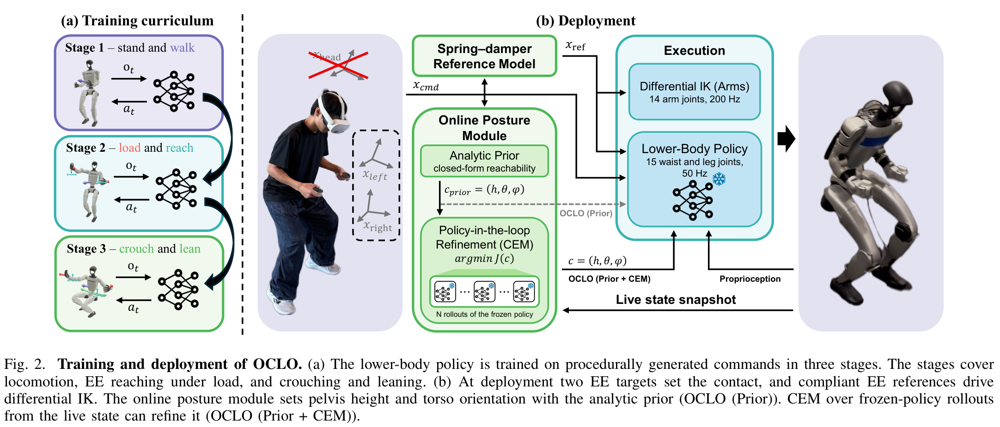

# OCLO：不用动作示范，如何在线决定顺应接触的身体姿态？

> **简短说明**：Dataset-Free Compliant Humanoid Loco-Manipulation 的 OCLO 用程序生成命令训练下肢策略，再根据双手目标在线选身体高度与姿态。它不需要人体动作示范，但仍依赖大量仿真训练。真机主要验证遥操作与受力顺应，不是视觉自主任务策略；加 CEM 并非每项都提高成功率。

**阅读范围**：Contact-Rich Loco-Manipulation Workshop Spotlight；公开 PDF 6 页，正文与附录 A–J 已通读，未审代码。阅读日期：2026-11-17。

**评测先看**：仿真 Track，解析 prior 82.2%，加 CEM 为 77.8%，同时朝向误差从 17.6° 降到 11.5°；真机每条件 10 次，强末端拉力下 prior 10/10。九项操作为遥操作能力展示，未报告各项 SR；安全吊架接触计失败，不能忽略评测装置。

## 1. 问题：双手要往下伸，谁来决定蹲多少？

[原文] 高层给双手目标和行走速度，不一定知道机器人需要如何蹲下、前倾或承受外力。固定站姿会导致手到不了，模仿人体姿态又需要动作数据。本文研究的是**由手部目标在线生成可达、可支撑的身体姿态，并允许接触力引起顺应位移**。[§I–III]

想象两手伸向低处箱子：手臂 IK 能追局部目标，却不能自行调整全身高度；下肢策略若没见过手部受力，也可能在拿起箱子时失衡。成功条件同时包含站稳、及时到达与保持末端误差阈值。研究不处理视觉目标识别、语言理解、抓取点自主选择或任务规划。

## 2. 思路：把可达性、姿态优化与力顺应拆开

[原文] 相比依赖动作捕捉先验的 SONIC，OCLO 用程序生成训练命令；相比要求外部显式给定姿态的接口，它从末端目标计算 prior，必要时用冻结策略 rollout 改进。[§II–III]

[推断] 两手很低时降低身体、很远时前倾，是低维几何规律，未必需要端到端策略自己从稀疏奖励中摸索。用 prior 缩小姿态搜索范围，再用实际下肢策略预测后果，可以避免在不可达的默认站姿附近盲搜。替代是直接训练端到端末端条件策略，接口更简洁；但文中该对照学到蹲姿后仍在多数任务较弱，不能据此断言所有端到端方案都不行。

## 3. 方法：从双手目标到手臂与下肢的两个控制环

### 数据和模块职责

| 模块 | 输入/训练 | 输出/运行 |
|---|---|---|
| 下肢策略 | 程序生成站走、带负载够取、蹲/倾等课程；受力扰动 | 15 个腿/腰关节，50 Hz；无人体示范不等于无仿真数据 |
| 手臂 IK | 顺应后的两个末端目标 | 14 个手臂关节，200 Hz |
| 顺应参考模型 | 用户末端命令与估计外力 | 质量—弹簧—阻尼参考轨迹；不需腕部力传感器 |
| 在线姿态 prior | 末端目标的低度与前伸量 | 身体高度 h、pitch θ、roll φ；CPU 约 0.07 ms |
| 可选 CEM | 当前状态，冻结下肢策略的候选 rollout | 64 候选、1 s horizon、2 Hz；优化身体姿态 |

[原文] §III、Fig.2、App.A–F。系统输入为两只手目标与速度指令；真机由手部遥操作和摇杆提供，不是 VLA 输出。

### 坐标系为什么重要？

末端目标使用重力对齐、随 base yaw 的参考系，但竖直原点固定在**支撑面**，不跟着 pelvis 升降。这样手要到某个离地高度，蹲下不会把目标一起带走。[§III-A]

解析 prior 形如 `h = max(h₀−k_h δ, h_min)`、`pitch = k_θ δ + k_η η`、`roll = 0`；δ 表示目标低于站立可达高度的量，η 表示前伸量。[Eq.2]

[推断·教学算例] 假设 h₀=0.7 m、δ=0.2 m、k_h=0.5，则 prior 高度为 0.6 m（还需 h_min 限制）。这些数仅为算例，不是论文配置。它把“低手目标”转成“身体下沉”，随后冻结策略负责动态执行；CEM 在这个初值附近搜索，而不是从任意姿态开始。

### 顺应性从哪里来？

平移参考用 `m ẍ_ref = k_p(x_cmd−x_ref) − k_d ẋ_ref + sat₄₀N(F_ext)`。其中外力来自电机力矩估计，截断到 40 N；旋转也用弹簧参考，但不接外部力矩。训练 k_p 在 12–24 随机化，硬件用中值 18，并采用近临界阻尼。[Eq.1、App.B]

若外界拉手，参考位置允许偏移，不要求手臂刚性死守；下肢同时要对由手传来的扰动有响应。估计力有噪声，小到约 1 N 的输入可能读成 0，不能当成高精度直接测力。参考模型不是碰撞安全证明。

CEM 代价综合跌倒、捕获点、末端/姿态误差、速度与力矩限制、平滑项；不需要物体类别或任务特定奖励。它改善可行姿态，不负责选择哪只脚移动到哪里、是否靠墙支撑或换握法。[§III-C、App.E]

## 4. 证据：姿态质量与成功率不是同一个指标

### 仿真证据表

各任务 90 个配对 episodes、每次 12 秒；常规条件要求 4 秒内到达末端目标并保持阈值、全程站稳；Crouched Push 只要求不倒，不能与其他任务直接平均理解。[Table I，p.4]

| 方法 | Track | Base Push | EE Push | Sustained Load | Crouched Push |
|---|---|---|---|---|---|
| OCLO prior | 82.2% | 61.1% | 62.2% | 64.4% | 45.6% |
| OCLO prior + CEM | 77.8% | 62.2% | 63.3% | 72.2% | 48.9% |
| B2：有目标训练，无外力训练，prior+CEM | 56.7% | 23.3% | 40.0% | 70.0% | 16.7% |
| SONIC + 同样 prior+CEM | 80.0% | 66.7% | 73.3% | 91.1% | 72.2% |

SONIC 使用约 700 小时人体动作，不能说是同数据预算对照；其姿态接口只接高度，且多数任务的末端朝向误差约为 OCLO 的 2–3 倍。Track 中 CEM 将朝向误差 17.6°→11.5°，SR 却 82.2%→77.8%。固定默认姿态、无 prior 的 CEM、端到端策略 Track 分别 15.6%、37.8%、43.3%，支持 prior 的作用，但不证明精细搜索处处更好。[§IV]

### ID / OOD 证据表

| 维度 | 已测试设置 | 边界 |
|---|---|---|
| 外力与负载 | 仿真冲击/持续负载，真机拉推 | 训练已有受力随机化；不是所有扰动都完全未见 |
| 控制器迁移 | 同一个在线 prior/CEM 接到 SONIC | 模块迁移，不是整套策略零样本跨机器人 |
| 物体/任务 | 九个遥操作演示 | 未报告按对象、场景、指令分组的匹配 ID/OOD SR |
| 自主感知/长期任务 | 不在本文接口范围 | 未报告，不能用遥操作示范代替 |

### 真机证据表

G1，安全吊架；每条件 10 次。跌倒、不可恢复踏步、接触吊架都算失败。以下 prior 与 prior+CEM 不是总体样本合并估计。[Table II，p.4]

| 条件 | prior | prior · SR/Wilson 95% | prior+CEM | 对照 B1 / B2 |
|---|---|---|---|---|
| 躯干拉，40–60 N | 10/10 | {{ci:10/10}} | 9/10 | 8/10；8/10 |
| 躯干推，手推未量化力 | 9/10 | {{ci:9/10}} | 9/10 | 7/10；8/10 |
| 末端拉，20–40 N | 10/10 | {{ci:10/10}} | 9/10 | 1/10；5/10 |
| 末端拉，50–70 N | 10/10 | {{ci:10/10}} | 未测试 | 未测试；未测试 |
| 末端推，手推未量化力 | 9/10 | {{ci:9/10}} | 8/10 | 0/10；3/10 |
| 侧向拉，40–60 N | 8/10 | {{ci:8/10}} | 8/10 | 0/10；2/10 |

Wilson 为阅读者计算；表中破折号解释为未测试，不是 0%。九个实际任务演示没有分别给试验数，不能据此形成九任务自主成功率。

### 一个容易遗漏的实现版本差异

[原文] App.F 报告 CEM 的 GPU A6000 版约 1.4 s，i9-14900K CPU 版 68±4 ms，机器人笔记本 Core Ultra 9 185H 上 22 次 replans 的 median 为 236 ms。**硬件 Table II 使用较慢的 Python rollouts**；不能把新 CPU 时延直接当作那组成功率的实测执行栈，也不能忽略进程/通信开销。

| 主张 | 机制与证据 | 剩余边界 |
|---|---|---|
| 不需人体动作数据 | 程序课程 + 下肢 RL | 仿真与工程调参仍有成本 |
| 在线姿态有用 | 默认姿态/prior/CEM 消融 | CEM 速度与收益有条件依赖 |
| 对外力顺应 | 受力训练消融、真机拉推 | 小样本、估计力噪声、没有自动接触规划 |

## 5. 反例与一周实验

[推断] 最强贡献是把末端目标转成低维身体姿态，而不用给高层暴露完整动作模仿接口。反例是手伸向侧后方、脚下狭窄或必须靠墙支撑：仅改变高度/pitch/roll 的候选族可能根本没有可行解，增加 CEM 算力也无济于事。

[猜测/待验证] 将同一组双手目标分别来自遥操作回放和 WAM，固定下层控制；测试延迟、目标跳变、摩擦与负载。比较 prior、prior+CEM，并记录末端误差、跌倒、耗时和命令拒绝。如果 WAM 条件下目标误差放大且 CEM 无法改善，就反驳“该接口可以直接无损接任何高层策略”的假设。

一周计划：第 1–2 天核验公开控制权重和仿真版本，复现一个 Track 条件；第 3 天校准支撑面与 yaw 坐标；第 4–5 天固定 seed 做 prior/CEM 配对；第 6–7 天加目标延迟和受力变化。有现成 G1 与吊架才复核低力硬件条件。代码、GPU 需求和权重公开性本次未核验，若缺失，缩小为解析 prior 和顺应参考模型的单元级仿真，不能冒充全系统复现。

## 面试口述版

OCLO 解决的是高层只告诉机器人两只手要到哪里，却没有告诉它该蹲多少、身体该前倾多少。它用程序生成命令训练下肢策略，用一个几何 prior 从手目标生成身体姿态，再选择性地用冻结策略 rollout 做 CEM 改进；手臂通过顺应参考和 IK 执行，这样外力可以让参考适度让步。

它确实不需要人体动作示范，但仍需要仿真训练，也没有完成视觉自主任务规划。实验还说明更复杂的 CEM 不是每项都更好：Track 朝向误差下降了，成功率却从 82.2% 降到 77.8%。对 WAM 来说，它提供了值得测试的底层接口；真正要验证的是高层参考带延迟和误差时，这个接口还能否保持可达性和平衡。

## 来源与修订

- [官方论文 PDF](https://contact-rich-loco-manipulation.github.io/papers/11-dataset-free-compliant-humanoid-loco-manipulation.pdf)：§III–IV，Tables I–II，Appendices A–J。
- [官方 Workshop 议程](https://contact-rich-loco-manipulation.github.io/program/index.html)：Spotlight 身份。
- 算例、Wilson 区间、反例与计划为阅读者补充；2026-11-17 初稿。
