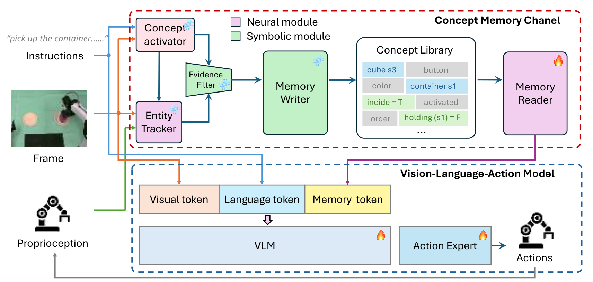
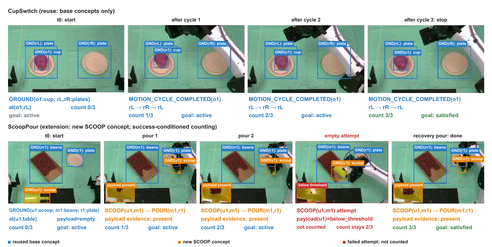

# ECoMEM：把“刚才发生了什么”写成可执行的概念记忆

> **简短说明。** ECoMEM 用固定 Writer 把观察与动作变成实体、关系、事件和顺序记录，再训练 Reader 将记录作为 token 接入 π₀.₅。RoboMME 16 任务均值 82.42%；两个真机任务合计 68/79 成功。这里的迁移是复用概念库并重新微调任务策略，ScoopPour 还新增了识别器；不是免训练迁移，也不是跨会话记忆。

核读：官方 Memory Workshop 的 21 页 PDF，正文、参考文献与附录 A–K。论文由 Yize Liu、Ke Wang、Mac Schwager、Yiqing Xu、Jiajun Wu 署名，Stanford University；Workshop **Spotlight** 身份见[官方列表](https://corl2026-memory.github.io/papers.html)。原文：[PDF](https://corl2026-memory.github.io/papers/033.pdf)。本文是证据核读，未运行源码或复现实验。

## ① 问题：一张图里没有“已经做过几次”

机器人把物体放回原位后，当前图像可能和开始时几乎相同；但“重复三次”的下一步取决于已完成的次数。物体被盖住、容器交换位置、视频展示过操作顺序时，也出现同样的观察歧义。多保存几帧提供了证据，却不保证策略从中提取正确的计数、身份与事件次序。

ECoMEM 研究的问题是：**能否用一个跨任务共享的概念库，构造足以区分这些历史的显式状态，再让动作策略学会使用它？** 贡献不只是存储格式，而是把概念的识别、持续更新和策略读取分开。Writer 固定，Reader 与策略训练；概念库可复用，但每个 episode 的记录从头建立。[§1–2，PDF pp.1–3](https://corl2026-memory.github.io/papers/033.pdf#page=1)

## ② 思路重建：先确定要记什么，再决定怎么编码

[推断，不是作者真实思考记录] 若失败来自“拿错被遮住的物体”，首先需要保持实体与容器的关系；若失败来自多舀一次，就需要确认完整的舀取—倒出事件，而不是数夹爪动作。二者需要的状态不同，但都可以由可组合的概念表达。因此先建立共享词汇，再按指令选择需要的概念，比给每个任务保存整段历史更直接。

下一步的困难是写入质量：检测器偶尔误认，动作命令也可能没有执行成功。于是概念不应在一次检测后立即变成确定事实，要累计证据、区分未知与否定、合并重复事件。最后才是读取问题：显式记录不能自动变成动作，仍需要 Reader 学会把它们送入策略。

这留下一个可检验的替代解释：收益究竟来自记忆，还是更强的额外感知与人工事件工程？论文用概念族移除、语言 grounding、概念选择和直接 VLM 抽取对照分解了一部分，但没有完全消除系统工程预算差异。

## ③ 方法：从一次“舀取并倒出”走到动作

**四类概念是四种问题。** Entity/Spatial Grounding 回答“是什么、在哪里”；State/Relation 回答“谁在谁里面、手里是否持有”；Event/Progress 回答“发生过什么、进度到哪里”；Temporal/Procedure 回答“先后顺序是什么”。概念库里的类型与 episode 中某个具体对象的记录不是同一层。

设指令为 ℓ，历史为 hₜ，记录为 mₜ，记忆 token 为 uₜ，当前观察为 oₜ：

`mₜ = W(ℓ,hₜ)；uₜ = Rφ(mₜ)；aₜ ~ πθ(a | ℓ,oₜ,uₜ)`。

W 不随策略训练更新；Rφ 与策略学习如何用记录选择动作。动作预测是 20 步，执行前 16 步，再用新观察更新；Writer 只看截至当前时刻的信息，没有偷看未来。[Eq.1、Appendix C](https://corl2026-memory.github.io/papers/033.pdf#page=2)

**Writer 的证据链。** 冻结的 OWLv2、SAM2 和机器人状态提供候选实体与事件证据；指令决定启用哪些概念。记录保留身份、关系、状态和证据来源；遮挡不会自动删除关系，也不会把“看不见”改写成“不存在”。完成事件须去重，后续证据可更新已有记录；新的完整周期才产生新的事件实例。

Appendix H 用带衰减的证据累计表达稳定性：

`Lₜ = clip[−B,B](2^(−Δt/h) Lₜ₋₁ + δₜ Σⱼ wⱼ sⱼₜ)`。

L 是证据量，h 是半衰期，s 是各路正负支持，δ 对单次时间增量封顶；确认与保留使用不同门限，减少反复跳变。**教学算例**：取未触及裁剪边界的 L=2、Δt=h、这次加权增量=0.6，则新值为 1.6。历史证据会衰减，但一次弱观测不会立即覆盖全部历史。这些数是演示，不是论文超参数。

**Reader 实际收到什么。** 每条记录有 11 个离散字段：kind、predicate、subject、object、truth、status、confidence、age、flags、row、column。各字段映射为 256 维向量、相加后归一化，经两层四头 Transformer，投影到 2048 维策略 token。空间位置量化为 32×32 网格，未知用 0；年龄分桶，置信度离散化。没有一个独立的“总次数”列：完成的事件实例与操作 ID 共同表达进度。实体 ID 在训练中做一致的随机置换，避免策略背诵编号。[Appendix H–I，pp.14–18](https://corl2026-memory.github.io/papers/033.pdf#page=14)

**训练与真机配方分开看。** 主仿真实验冻结 Writer 和视觉编码器，训练语言主干、动作专家及 Reader；16 任务联合训练，4 张 H200 约 24 小时，使用同一个 EMA 检查点。评测的三个 seed 是策略采样 seed，并非三次独立训练。真机附录另称全参数微调：两个任务各保留 59 条机器人示范，分别训练有/无记忆策略。不能将这两种训练设置混写为“全部冻结”。

真机是 YAM 的右臂，6 关节加夹爪，顶视与腕视相机。ScoopPour 新概念结合工具/盘子检测、负载外观与“装载→在盘上变空”的连续证据；空勺不计数。识别器开发含 agent 辅助检查与用户反馈，使用少量示范进行开发和额外核验。Writer 在 ScoopPour 为 5 Hz、CupSwitch 为 10 Hz；这不是完整控制链的端到端推理速度。[Appendix K，pp.20–21](https://corl2026-memory.github.io/papers/033.pdf#page=20)

## ④ 实验：概念有效，证据有不同强度

**仿真表。** 16 任务，每任务每 seed 50 episodes，3 个采样 seed。主表旧基线来自 RoboMME 初版论文，而非全部重新运行的同预算实验。

| 比较 | 结果 | 能支持什么 |
| --- | --- | --- |
| ECoMEM / FrameSamp-Modul | 82.42 / 44.51%，+37.91 点 | 在这个协议的系统级优势；不能当成等算力纯记忆增益 |
| ECoMEM / MemER | 82.42 / 42.38% | 共享概念方案的效果，不是所有检索方法的上限 |
| 去空间 / 去进度 / 去顺序 | VideoUnmask 84→18；PickXtimes 62→14；PatternLock 60→12 | 分别训练的较低预算消融，不能将 84 与主表 100 直接相减 |
| 启用所有 recognizer | VideoUnmask 84→42；VideoRepick 64→8 | 无关记录与额外识别并非无害 |
| 去语言 grounding | 闭环 43/50→12/50；36/50→1/50 | 泛化角色提示不能替代具体实体 grounding；策略本身仍看到完整指令 |

概念选择还降低初始化时间：两任务中位数由 40.47→2.23 秒、52.66→4.38 秒；测量含第一次模型载入/暖机，不含 VLA 载入和动作推理。**这不是每个动作快十几倍。** [Tables 1–4、Appendices B、I–J](https://corl2026-memory.github.io/papers/033.pdf#page=3)

直接抽取对照中，Qwen3-VL-8B 在当前状态问题较强，顺序与 before/after 较弱；但它使用特定数据拆分、LoRA 和 64 帧输入，不能扩张成“VLM 无法做记忆”。标签主要由仿真回放自动生成并审查，不是所有样本独立人工真值。

**ID/OOD 表：按变化轴记录。**

| 变化轴 | 观察 | 证据边界 |
| --- | --- | --- |
| 任务 / 概念复用 | 同一库覆盖 16 任务；新真机任务复用或加一概念 | 真机策略重新训练，不是零样本新任务 |
| 请求次数 | ScoopPour 训练为 2/3 次，测试包含 1 次 | 是有限计数目标变化，不是对象/环境 OOD |
| 遮挡 / 身份交换 | 专门的 RoboMME 任务测试 | 训练任务族内的记忆需求，不自动等于未见分布 |
| 新对象、光照、载荷、动力学 | 未提供统一的分层 ID→OOD 次数表 | 不推导跨环境、跨身体通用成功率 |

**真机表。** 成功必须完成恰好要求的次数；达到次数后停不下来、超时仍失败。以下 Wilson 95% 区间由给出的次数计算；各条件次数不相等。

| 任务 / 次数 | ECoMEM | 无记忆 π₀.₅ |
| --- | --- | --- |
| ScoopPour ×1 | 16/20 · {{ci:16/20}} | 4/12 · {{ci:4/12}} |
| ScoopPour ×2 | 19/23 · {{ci:19/23}} | 0/12 · {{ci:0/12}} |
| ScoopPour ×3 | 11/12 · {{ci:11/12}} | 0/11 · {{ci:0/11}} |
| CupSwitch ×2 | 11/12 · {{ci:11/12}} | 0/12 · {{ci:0/12}} |
| CupSwitch ×3 | 11/12 · {{ci:11/12}} | 1/11 · {{ci:1/11}} |
| 合并 trial | 68/79 · {{ci:68/79}} | 5/58 · {{ci:5/58}} |

合并试次的 86.08% 与五条件等权平均的 87.52% 不同；基线分别为 8.62% 与 8.48%。合并区间仅描述这组异质试次，不能视为所有任务的总体可靠性。[Table 9，p.21](https://corl2026-memory.github.io/papers/033.pdf#page=21)

## ⑤ 攻击与延伸：可靠记忆不能只“写得出来”

**最脆弱假设。** Writer 能持续给出正确的实体绑定与完成事件。若遮挡时物体被别人移动，持久关系可能过时；若勺子只倒出一半、相机误判变空，计数就会把失败固化为事实。主表的高分没有证明长时、多主体环境中的可撤销记忆。

[待验证] 最小对照先固定同一策略、同一感知模型与计算预算，比较原始历史、结构化记录、打乱记录、oracle 记录；注入单个漏事件或错绑定，测错误如何传到动作，并报告检测/恢复延迟。分别统计感知写错、读取错、控制执行错，不能用“记录内部已验证”替代外部真值。

[推断：对 WB-WAM 的用途] 可先把支撑状态、接触对象、双手分工、已完成搬运次数做成少量显式概念。Writer 输出应带时效与置信度，动作端仍使用实时几何；接触是否建立要靠物理证据，不能只看指令已发出。人形增加接触与平衡变量后，需重新验证写入规则，桌面成功不构成全身控制保证。

**一周最小实验建议。** 选一个两次重复放置任务与一个遮挡交换任务；收集带事件标签的小规模回放，在同一冻结低层策略上先测试 Writer 错误和记忆读取的边际收益。预算不足以重训原文模型时，将结果称为“概念记忆接口验证”，不称为 ECoMEM 复现。

## 面试口述版

ECoMEM 的要点是把历史变成可更新的任务状态，而不是多给策略几张图片。Writer 用感知和机器人状态确认实体、关系、完成事件与顺序，Reader 再把这些记录变成策略 token。这样重复三次不是让模型猜历史里出现了几次动作，而是读取经确认的事件。它在 RoboMME 与两个真机任务上有明显收益，但 Writer 有工程和感知依赖，真机策略也重新微调过。我更想借鉴它的分工：语言提出需要记什么，物理证据决定发生了什么，策略学习如何用记忆；同时要测试错误记录怎样被撤销，否则记忆会稳定地记错。

## 证据索引与未覆盖项

方法 §2、Fig.1；主结果 Table 1；概念/Writer 消融 Tables 2–4；Reader 与训练 Appendix C/H/I；VLM 对照 Appendix J；真机配方及逐条件次数 Appendix K/Table 9。全部 21 页已核读。未报告的分层 OOD、真实闭环总延迟与长期跨会话维护均保留为未知。原图版权归论文作者。
