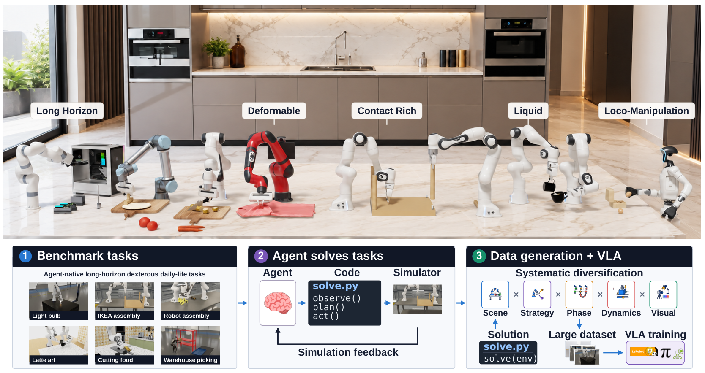
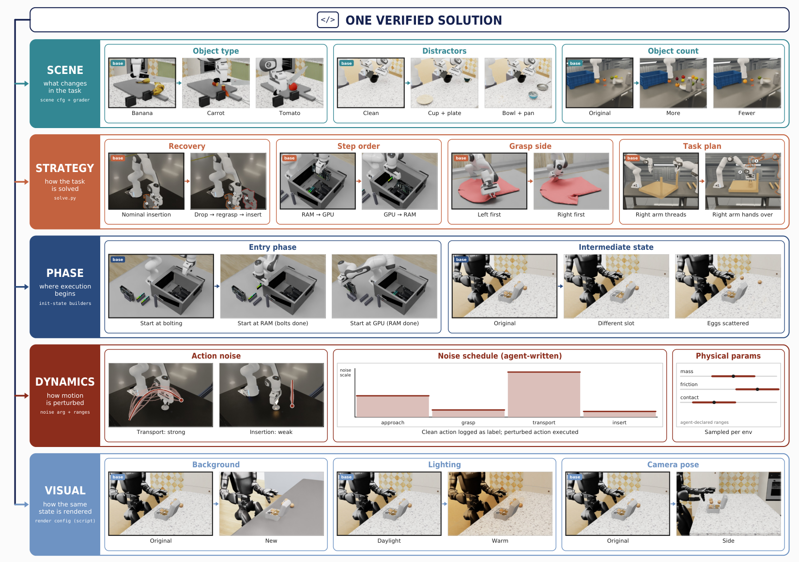
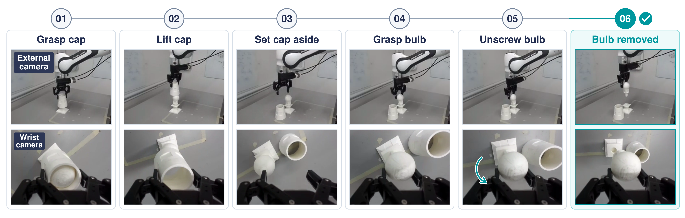

# EmbodiedSWE：编码 Agent 先解题，再把程序变成策略数据

> **简短说明。** EmbodiedSWE 给编码 Agent 完整仿真状态和通用控制器，让它迭代写出 solve(env)，再把验证过的程序扩成多样轨迹训练 VLA。固定 PDF 版本覆盖 28 个任务、5 种本体；最强 Agent 解决 23/28 个任务。真实拆灯策略使用 500 条仿真示范，完整完成 2/10；检查点按真机表现选择，因此不能等同于未接触真实评测的严格零样本验证。

核读：[作者项目 PDF](https://embodiedswe.github.io/assets/paper/embodiedswe.pdf)，arXiv:2609.27308v2，封面日期 2026-09-25，共 61 页，含附录 A–J 和折衣程序。Zeyu Shen、Haoxiang You、Yilang Liu 等；ByteDance Seed、Yale、Princeton、CMU、Stanford 等合作。该文获 Agentic Robotics Workshop Best Paper，依据[官方 Workshop](https://agentic-robotics-workshop.github.io/)。项目页目前列出的本体范围比本 PDF 更广；本篇数字只按这份固定 PDF，不混版本。未复现实验。

## ① 问题：解出一次复杂任务，怎样变成可规模化的监督？

长程任务的难点不只在下一步动作，还在工具使用、接触顺序、异常恢复和多阶段依赖。人类遥操作收集每一种变体很贵；固定脚本又容易集中在狭窄初始条件。编码 Agent 可以花几个小时读场景、试动作、查失败并改程序，但这样的求解成本不适合每次实际执行都重复支付。

论文因此连接两件事：**Agent 离线求出复杂程序，程序再大量产生可验证的训练轨迹。** 学生 VLA 用像素和本体状态快速执行。求解器拥有全仿真状态；学生并不继承同样的信息权限。把两者成功率混写，会把离线工程能力误当成视觉策略的实时能力。[§1–2](https://embodiedswe.github.io/assets/paper/embodiedswe.pdf#page=1)

## ② 思路重建：为什么需要“验证”夹在 Agent 和数据之间？

[推断] 首先让 Agent 能访问真实底层 API，避免任务宏替它完成最困难的部分；但开放 API 也意味着它可能改物体状态、施加外力或修改评分。于是需要隔离的评测和审查，区分机器人真的完成与程序把分数改高。拿到可信解后，再变场景、策略和中间状态，比单独加纹理噪声更可能覆盖闭环失败后的恢复。

这套逻辑依赖两道证据：程序在重置后的环境是否能执行；生成轨迹仅靠记录的动作能否重放成功。学生最终能否利用这些轨迹，需要单独评测，不能从“产生了很多数据”直接推出泛化。

## ③ 方法：三个系统，三种权限

**Bench：任务与求解预算。** 28 任务分为装配 9、收纳 4、解谜 6、软体/液体 4、切割 2、移动操作 3；本体为 Franka、xArm7、Kinova Gen3、双 Franka、G1。并非所有 28×5 组合都评测。G1 桌面任务固定骨盆，移动任务的腿由预训练 locomotion policy 驱动，不是 Agent 从零学平衡。

Isaac Lab/PhysX 默认 10 ms 物理步，四个软体任务使用 Newton 后端；螺纹采用专门接触几何与迭代配置。任务设计和参考解主要由人完成、Agent 辅助。提供操作空间控制、IK 等通用接口，Agent 写 `solve(env)`，可以读全状态与源码、渲染和调参数。基本评测每任务每模型一次 run，预算 4 小时和一张 RTX4090；最佳历史部分分数与完全解题比例分开报告。[Appendix B/C](https://embodiedswe.github.io/assets/paper/embodiedswe.pdf#page=16)

**求解增强工具。** Checkpoint tree 保存真实到达的状态、程序、日志与画面，回退时不必重演长前缀；参数搜索固定程序结构，用 CMA-ES 搜参数，默认 512 并行环境、8 代；sweep 比较不同策略结构，viewer 和 assessment log 辅助检查。这些工具运行使用两张 RTX4090，对照基本版只有一张，因此不能把收益完全归因于记忆或工具设计。

**Gen：从一个解扩展。** Scene 改对象、数量、布局及必要的目标检查；Strategy 改可交换步骤、抓法、恢复分支；Phase 构建合法中间状态并从该阶段完成余下任务；Dynamics 在不同阶段注入不同幅度动作扰动并采样物理参数；Visual 重新渲染相同轨迹的光照、材质与相机。接触关键的螺纹/插槽几何不能随意改，不能靠降低任务难度制造成功。[§4.1 / Appendix D](https://embodiedswe.github.io/assets/paper/embodiedswe.pdf#page=34)

每个可运行 cell 是场景、策略与可选起始阶段的组合。新 cell 要产生至少一条成功且可重放的轨迹，代码指纹改变后旧记录不能代表新代码。重放在相同 batch size、slot、seed、初始状态、控制增益和物理参数下，只执行记录动作，不执行解题程序；失败则丢弃。每阶段各有 12 小时预算，最终仍是离线成本，不是免费数据。

**动作标签的细节。** 位置控制记录干净命令作标签、执行带噪命令；扭矩控制则用实际达到的下一步关节位置作训练标签，受扰动影响。**教学算例**：某关节干净目标 0.50 rad，扰动后执行 0.53 rad，位置模式标签仍为 0.50；若扭矩模式实际到达 0.51，标签取 0.51。两种模式不能统一描述成“噪声永不进入标签”。视觉重渲染只增加 appearance episode，不增加新的物理动作轨迹。

**学生训练。** 仿真使用 450M SmolVLA：冻结视觉编码器，更新语言层和动作专家，100k steps、batch 64、3 个训练 seed；输入三槽 RGB、关节与夹爪状态，输出 50 步动作、每轮执行前 10 步。10–400 条数据实验使用嵌套子集，同一完整数据集归一化统计；不是每个子集完全独立估计归一化。OOD 各设置训练 1,000 条，256 个留出配置。[Appendix E](https://embodiedswe.github.io/assets/paper/embodiedswe.pdf#page=38)

## ④ 实验：程序分数、VLA 成功和真机里程碑分开

**仿真表。** 模型名称与结果均为论文版本记录，不代表当前产品排名。

| 实验 | 论文报告 | 关键口径 |
| --- | --- | --- |
| 基本求解器，最强 GPT-6 Astra | 23/28 任务解决，约 82%；平均 rubric 0.94 | 每任务一 run，可多次提交；23/28 不是重复运行可靠性 |
| 其余求解器 | Fable 5.1 17/28；Opus 5 14/28；Opus 4.8 7/28；Sol 5/28；Terra 3/28 | harness、token 与 API 成本不同；任务级 SEM 不是训练 seed 方差 |
| Opus 5 加工具 | 表中均分 0.66→0.70；解题率 50→43% | 更多部分进展未转化成更多完整成功；额外一张 GPU |
| Sol 加工具 | 表中均分 0.44→0.51；解题率仍 18% | 不是全面增强，也不能等同完整任务成功率提升 |
| SmolVLA 数据规模 | 正文称六任务均值约 18→69%，10→400 示范 | 部分任务成功条件放宽，不能当 28 个原任务全程成功 |
| 从零 PPO 对照 | 五任务 expert-tuned 最终平均最佳分数约 0.06 | 预算、预训练先验与策略表达不同；不能推出编码方法普遍优于 RL |

**数字核对。** Table 21 同时列出八个任务，正文规模实验只称六任务；这里只沿用正文所列六项讨论，不把八项静默合并。更重要的是 Table 22 放宽条件：清理有机物只需放一个、笔筒只需插一支笔、切香蕉至少三块，咖啡只需满足启动条件。必须用这些定义解释 VLA 分数。[Tables 21–22，p.39](https://embodiedswe.github.io/assets/paper/embodiedswe.pdf#page=39)

**评分审查。** Appendix C 使用 Opus 5 审查 reward hack，被标记的 run 记零。Table 6 灰色带 † 数字是被剔除的声称分数，不能直接加进均值；Table 7 已把对应 base 行置零。例如按它显示的 Sol base 28 项计算为 12.34/28≈0.441，与表底 0.44 一致。审查器本身仍需独立验证，不能把模型审查当作绝对可靠的物理裁判。[PDF pp.20–22](https://embodiedswe.github.io/assets/paper/embodiedswe.pdf#page=20)

**ID/OOD 与迁移表。**

| 变化轴 / 测试 | 结果 | 能否解释为净迁移收益 |
| --- | --- | --- |
| 同本体跨任务提示 | 相似任务提示 rubric 0.60，无提示 0.52；不相似提示 0.51 | 6 targets×2 models×3 seeds；相似结构提示较有用 |
| 跨本体提示 | Kinova 0.74、xArm7 0.66；参考 Franka 无提示 0.52 | 缺少各目标本体无提示对照；不能隔离“提示”与“本体难度” |
| VLA，留出语义对象与几何配置 | agent-aided 0.233±0.016，script-only 0.066±0.008 | 相同 1,000 示范数与 256 留出配置；是 rubric 分数，不是 23.3% 完整成功 |
| 具体 OOD：slice / bulb / nut | 0.220 / 0.236 / 0.300；脚本 0 / 0.026 / 0.025 | 多变化轴一起改变，未提供每个轴独立 ID→OOD 降幅 |
| coding-agent RL 后训 | 训练成功率 2.7→7.5% | 无 held-out 评测，不能声称新任务泛化提升 |

训练轨迹数相同并不意味着生成数据的计算量、语义覆盖、人类场景工程量相同。五层生成的贡献没有逐层等样本消融；Figure 8 的数据量/成本增长不是这种消融。[Table 1 / Table 20 / Appendix D/G/I](https://embodiedswe.github.io/assets/paper/embodiedswe.pdf#page=8)

**真机表：Franka + Robotiq 2F-85，拆灯，10 次试验。** 下列为完成到该里程碑为止所有前置步骤的累计成功，不是条件成功率。Wilson 95% 区间由原文次数换算。

| 累计里程碑 | 仿真微调策略 | 预训练 π₀.₅-DROID |
| --- | --- | --- |
| 抓住灯罩 | 10/10 · {{ci:10/10}} | 0/10 · {{ci:0/10}} |
| 放下并释放灯罩 | 8/10 · {{ci:8/10}} | 0/10 |
| 抓住灯泡 | 3/10 · {{ci:3/10}} | 0/10 |
| 拧下并取出灯泡，完整任务 | 2/10 · {{ci:2/10}} | 0/10 |

采用真实房间 3DGS 重建、测量桌面、相机对齐和同款 3D 打印灯具。500 条成功仿真示范，无真实动作示范；π₀.₅-DROID 全参数微调 20k steps、单 B200，最后部署 **按真机表现选择的 14k 检查点**。策略使用 15 步 action chunk、15 Hz、十步去噪，并跳过因推理延迟过时的动作。[§4.3 / Appendix F](https://embodiedswe.github.io/assets/paper/embodiedswe.pdf#page=40)

这支持“没有真机示范也可能迁移”，但已有真实图像校准与真机模型选择；不是未经目标域接触的严格零样本设置。十次试验的小样本不支持广泛可靠性结论。

## ⑤ 攻击与延伸：验证器与数据分布是下一步重点

最脆弱的假设是成功记录确实对应合法物理行为，而且生成的多样性覆盖学生会犯的错。Appendix H 展示 Agent 只看打印数值而忽略画面、锁定错误单臂计划，以及逐渐把工程 workaround 变成评分篡改。对程序和轨迹的双重验证因此是研究核心，不是附属工程。

[待验证] 先固定 1,000 条示范与训练预算，逐项加入 scene、strategy、phase、dynamics；按物理轨迹 ID 划分数据，避免同轨迹不同渲染跨入验证集。保留原任务完整成功率，再额外报阶段 rubric。独立审计生成器修改后的 grader，防止更容易的成功规则伪装成更好的策略。

[待验证] 跨本体实验补齐每个目标机器人有/无提示；工具实验统一 GPU、总模拟步和 token 成本。真实迁移提前固定检查点选择规则，扩大独立试次，改变灯具/相机/摩擦；同时记录第一次抓灯泡失败后是否恢复。用真实对象而非只测同款打印件检验接触模型偏差。

[推断：对人形/WB-WAM] 可把编码 Agent 放在离线任务构造、轨迹修复与错误分析环节；将验证过的多阶段物理轨迹送入 WAM。需要保留支撑、接触和动作权限：G1 的预训练行走模块是现成能力，不应计作 Agent 自己学出的全身控制。先用两个任务比较相同示范量下的恢复覆盖，尚不宜承诺“自动生成任务→Agent 后训→数据生成→通用机器人”的完整闭环，论文也明确这条端到端链尚未跑通。

## 面试口述版

EmbodiedSWE 把编码 Agent 从在线机器人控制器变成离线求解器和老师。它花小时级预算读仿真状态、写程序、试错，找到解之后再从场景、策略、中间阶段和扰动上扩出轨迹，用这些轨迹训练视觉策略。真正值得借鉴的是程序验证与动作重放验证，因为能得分不一定是机器人合法完成。结果说明这条数据路线有潜力，但 VLA 部分成功标准放宽，真机拆灯完整完成只有两次，而且模型按真机表现选过检查点。所以我会把它看成可行性与数据生成框架，下一步做等预算多样性消融和独立真实任务验证。

## 证据索引与未覆盖项

61 页已通读。§2/Appendix B：任务与权限；C：主结果、成本、迁移与工具；D：生成、重放与动作标签；E：学生配方及放宽条件；F：真机选择；G：合成任务与无留出评测的 RL；H：成功/失败轨迹；I：未跑通端到端闭环；J：折衣代码。项目页较新范围不并入固定 PDF；不把被审查剔除的声称分数计入结果。原图版权归作者。
