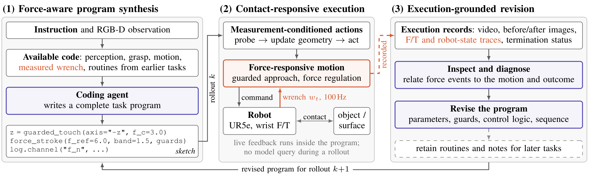

# FORCA：让 Agent 改写力反馈程序

> 简短说明：FORCA 根据图像和腕部力/力矩记录生成、试运行并修改 Python 控制程序。执行中的力反馈由程序以 100 Hz 处理，Agent 在两次执行之间诊断失败。五个真机任务支持这个思路，但成功程序来自数十次以内的实体试错，并非首次尝试就成功。

## 1. 问题与关键判断

接触任务不只需要决定“做什么”，还需要决定“碰到了以后怎样调整”。视觉难以提供透明把手的深度、物体摩擦或刀片是否离开表面；FORCA 把这些证据交给可修改的程序，而不是要求基础模型每 10 ms 直接生成动作。（§I–III）

贡献包含两层闭环：**执行内**按力测量修正速度与阶段切换；**执行间**结合视觉结果和力轨迹改程序。记忆保存在可复用代码和笔记中。它与固定力控 primitive 的区别，是 Agent 可以修改条件、顺序与反馈逻辑；没有单独实验充分拆开这几类修改各自的贡献。

## 2. 数据与人工投入

“无需任务训练”描述模型权重不做任务微调；开发程序仍消耗真实机器人交互、基础模型先验和人工维护的初始工具。（§III-A、IV-A，pp.2–4）

| 项目 | 原文设置 | 读法 |
|---|---|---|
| 硬件 | UR5e、腕部 F/T、WSG-50、固定 RealSense D455 | 不是全身人形，也不是指端分布式触觉 |
| Agent | PDF 明示 Claude Fable 5 做分析与代码编写 | 模型名称按原文记录，不由此推断今天可获得的 API 或成本 |
| 初始技能 | 人监督组装的 SAM 3、GraspGen、PyRoki 等感知/抓取/轨迹模块 | 不是从空白代码开始 |
| 每次开发 | 最多 20 rollouts 且最多 4 小时；到预算或 Agent 判定收敛即停 | rollout 包含写/改程序与一次真机执行 |
| 人工角色 | 执行授权、场景操作、最终验收 | 不是无人值守自主部署 |
| 最终评估 | 冻结程序再重复测试；超过硬编码 30 N 停止且记失败 | 开发成功记录与冻结测试不可合并 |

Vision-only 对照沿用同一基础模型、指令和基础技能，但生成、修改、执行均看不到实时或历史 wrench，也无力响应例程。底层安全保护仍开启，离线评测记录的力不提供给它。这个对照检验整套力信息路径的增益，不能独立证明每一个模块都必要。

## 3. 机制：探测、调节、事后改写

先通过接触校正几何，再通过实时力反馈维持接触；失败后把力事件与图像中的结果对照，改写下一版程序。理解这三步能避免把分钟级 Agent 推理与毫秒级控制混为一谈。（Fig.1、3）

图中左侧生成完整程序，中间循环在机器人与程序之间，右侧才调用 Agent 检查记录。中间明确写有“no model query during a rollout”：基础模型不在实时力控环中。

**探测**：腕力超过接触条件时，用当时机器人位姿加工具几何更新表面或把手位置，再在同一次 rollout 内抓取。**持续接触**：主机 100 Hz 经 RTDE 读 wrench 与状态，更新笛卡尔速度，可按力误差升降工具，也可在接触不足时停止前进。**修改**：Agent 可写分析脚本定位异常时间段，再调整阈值、guard、控制规则和动作顺序；执行前还有代码、可达性与工作空间检查。

**教学微例（由 Fig.3 简化逻辑推演）**：目标力 6 N，前进许可条件 `F > 4.5 N`，前进速度 20 mm/s。一个 10 ms 周期若读到 3 N，则前进距离为 0；读到 6 N 时才前进 `20 × 0.01 = 0.2 mm`。这解释为什么停等恢复接触能减少漏削。它不是论文给出的通用控制器方程或完整安全策略。

门把手案例还展示了**状态转换条件**的修改：第 16 次把 49.7° 误判为末端挡块，修订为超过 65° 才接受 end stop，并等待力下降再拉门（Table V）。这属于从物理记录修正程序判据，而非单纯把目标力调大。

## 4. 证据：冻结测试、适应过程与展示分开

先看程序开发后的重复试验，再看迁移是否允许继续修改；擦除比例和接触时间占比都不是二项任务成功率。（Tables I–IV，pp.4–7）

### 仿真证据协议

| 字段 | 核验结果 |
|---|---|
| Benchmark / split / trials | 本文不使用仿真进行程序开发或任务评测，未报告仿真SR。§I、IV |
| 适用范围 | 五个真实任务的开发与冻结程序测试，不能外推仿真到真机差距。 |

### ID / OOD 的维度

| 变化 | 训练/开发暴露与测试 | 结果与可比性 |
|---|---|---|
| 静态→人手移动花瓶 | 静态开发完成后冻结，不再修订 | 去除率99%→93%，失接触0.7%→1.6%；各10次，任务运动条件不同。Table II |
| 物体形状/质量、表面摩擦 | 方块/圆柱与白板/木板；新条件继续改程序 | 三配置首次执行后的修订平均2次；不是zero-shot成功率。Fig.6/Table IV |
| 新门型、全新任务组合 | 未报告匹配ID/OOD重复试验 | 不计算泛化下降或保留率。 |

### 真机协议与失败边界

| 字段 | 核验结果 |
|---|---|
| 设备 / 观测 / 控制 | UR5e+WSG-50、RGB-D与腕F/T；生成程序100 Hz更新速度，模型不在rollout内查询。§III–IV |
| 预算 / 次数 | 开发≤20 rollouts且≤4 h；最终每条件10次。程序可能因到预算而停止。 |
| 人工与安全 | 人负责执行授权、场景操作、最终验收；达到30 N停止并记失败。§IV-A |
| 耗时与失败 | 推理每轮4–10 min、动作1–3 min；错深度、抓握滑脱、未解锁、失接触等见Table V；冻结测试完成时间未逐任务报告。 |

| 冻结程序测试 | Vision-only | FORCA | 样本与含义 |
|---|---|---|---|
| 开抽屉 | 4/10，{{ci:4/10}} | 10/10，{{ci:10/10}} | 95% Wilson 区间；十次全中仍不能推出可靠性为 100% |
| 开门把手 | 1/10，{{ci:1/10}} | 10/10，{{ci:10/10}} | 同上，未给跨门型分层 |
| 静态擦花瓶 | 去除 73%；失接触 42.6% | 去除 99%；失接触 0.7% | 各 10 次平均 |
| 手持移动花瓶 | 去除 21%；失接触 55.9% | 去除 93%；失接触 1.6% | 静态程序直接迁移，无再次修改 |
| 手持黄瓜削皮 | 削皮 37.4%；失接触 40.6%；过力 13.4% | 削皮 81.1%；失接触 2.2%；过力 2.7% | 各 10 次平均，不是完整成功率 |

抽屉平移误差从 8.3±5.4 降到 5.3±1.6 mm，门把手从 65.3±16.9 降到 20.0±0.9 mm（Table I）。最终成功不意味着定位误差消失。

失接触定义为力低于阈值并持续至少 0.2 s：擦拭 1.5 N、削皮 0.8 N。分母是有效任务时间，**包含等待恢复接触，排除初始接近和主动抬离**。削皮过力阈值为 10 N；30 N 是另一个硬停止阈值。正文 Fig.3 的力曲线/皮肤缺口经过理想化，Fig.8 的 90.6% 是代表性单次结果，不能替代 Table III 的 81.1% 均值。

**部署适应**：敲击任务把 61.9 g 方块换成 663.6 g 圆柱，或白板换木板。新条件允许继续查看力与末态并改程序；Table IV 的“2 次”是三个新配置中**第一次执行之后的平均修订次数**，不是从零学习只需两次交互。原参考条件从零开发用了 13 次。

**成本**：抽屉 8 次、门把手 17 次、擦拭/削皮各用满 20 次预算。每轮 Agent 推理 4–10 分钟，机器人运动 1–3 分钟。门把手开发轨迹第 17 次成功、18–20 次复跑最终程序；这与另行冻结评测的 10 次需要分开。

**仿真 / ID–OOD / 真机**：本文没有仿真成功率；实体五任务是核心证据。静态到手持花瓶是明确无修订迁移；换物体/表面敲击是有交互适应，两者不能统一称 zero-shot。

## 5. 可以带走什么，还缺什么

FORCA 对 Agent 与 Memory 的启发，是把经验保存为可检查的执行条件，让接触反馈真正参与动作，而不只作为事后语言描述；代价是实体试错和对诊断能力的依赖。（§V–VI）

腕 wrench 把多处接触汇总，无法直接告诉 Agent 哪根手指在哪里受力。作者承认长动作序列、紧力约束可能使诊断失效，且分钟级推理昂贵。仅比较视觉版不足以回答“固定力控 + 相同探测”能达到多少收益；没有代码复用检索、历史错误累积的长期评测。

[推断] 对人形部署，应把上层程序修改与现有高频全身稳定控制分开测试。先固定控制器比较：手写力控、Agent 只调参数、Agent 可改状态转换三组；统一真机试错预算、重置次数和失败成本，再测新的物体、接触位置与扰动。本文的 UR5e 结果尚未证明这套方法可直接安全管理人形平衡。

继续阅读 Gated Memory Policy：它把经验压入学习得到的记忆；FORCA 把经验留在代码中。两者的可检查性、数据需求与失败恢复方式很不同。

### 一周实验草案与口述版

[推断] 一周内可做的最小验证：固定一个低风险接触任务及30 N以下的适用限值，由实验者另行设定实际安全参数；比较手写反馈、Agent调参数、Agent改逻辑，给相同试错次数；冻结后换表面重复测试并记录总时间与人工重置。这是复现实验建议，尚未执行。

**一分钟口述**：FORCA把经验写进程序。Agent看一次执行留下的视觉和力记录再修改代码，实时反馈由程序处理。十次全中发生在开发后，不能忽略前面的实体试错。

## 原文与阅读范围

- [FORCA，arXiv 2610.31841v1](https://arxiv.org/abs/2610.31841v1)，2026-10-22；[固定 PDF](https://arxiv.org/pdf/2610.31841v1)。已核读全部 8 页，包括末页 Table V、图注与参考文献；没有另列附录。
- [Learn@Deploy Workshop](https://learn-at-deploy.github.io/) 列为 Spotlight。文中数值来自该固定 PDF，教学计算与研究建议另行标注。
