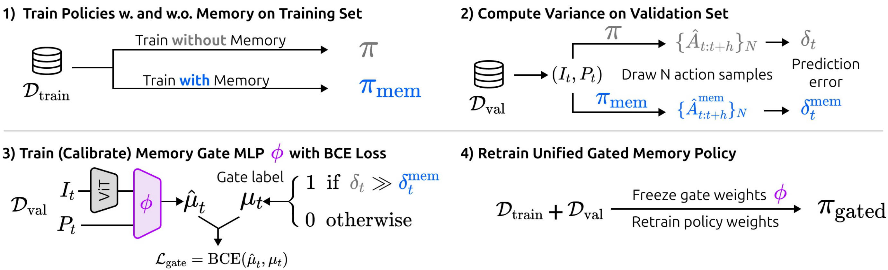
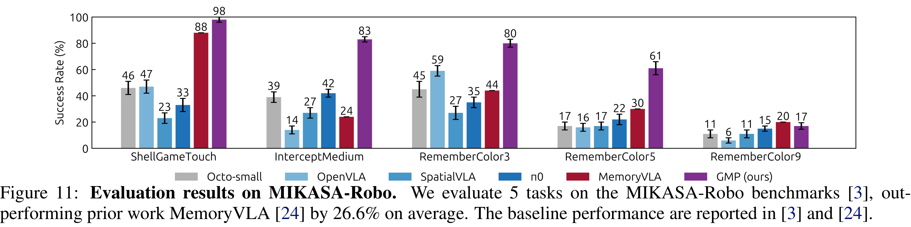

# Gated Memory Policy：不仅记住，还要知道何时调用

> 简短说明：GMP 在扩散策略中用交叉注意力读取图像与动作历史，用经过验证集校准的二值门决定何时读取，并对历史动作加噪来降低过拟合。它能在多次试验之间调整动作，但学到的适应过程来自训练示范；部分最醒目的真机任务实际上采用始终开门配置。

## 1. 问题：长历史为什么反而会伤害策略

历史既能消除当前状态的歧义，也会增加输入维度、噪声和训练部署差异。GMP 把“是否需要过去”与“过去哪一段有用”分开学习，目标是兼顾无记忆、单次执行记忆与跨试验适应。（§1–3）

**In-trial** 如把杯子放回起点，需要记住曾经的位置；**cross-trial** 如重复抛掷，需要结合上次动作和落点调整速度。后者是上下文内适应，部署时没有梯度更新。基础模型预训练、任务示范训练、试验内上下文适应是三个不同层次。

## 2. 数据血缘：记忆策略怎样学会试错

跨试验能力并非凭空出现：示范本身包含逐次试错的过程，而且部分启发式教师读取真实物理参数。需要把教师权限和测试策略权限分开。（补充 §8.3–8.6，pp.13–19）

| 数据/任务 | 监督来源与规模 | 重要限定 |
|---|---|---|
| 视觉编码 | SigLIP2-B/16 预训练；DP/PTP 对照采用相同编码器 | 任务策略仍需训练 |
| T1/T2 颜色/位置记忆 | 启发式轨迹；T1 300 episodes，T2 沿用其采集设置 | 固定暂停位避免当前姿态泄露答案；最终配色固定，把 T1 配置从 2304 降到 96 |
| T3′ 连续放回 | iPhUMI 人工 262 episodes | 40 个真实初始状态测试 |
| T3 野外翻杯并放回 | 1274 条放回、588 条翻杯、304 条组合；12 杯、30+ 场景 | 不是只用 304 条演示；测试 6 个未见环境、10 杯，共 20 episodes |
| T4 推物 | 500 episodes；教师知道摩擦 0.005–0.015，用二分式速度调整 | 测试策略不知道摩擦；只控制 y 轴 |
| T5 甩布 | 500 episodes；质量从七个值 0.1–2.0 kg 加小扰动 | 布焊在夹爪上；只控 x/z；仿真有穿透等问题 |
| T6 真机 casting | 80 episodes、两种底面；先 1.8 m/s，再按已知类别用 1.4 或 2.2 m/s | 只有两种训练物理条件；测试也是两底面各 10 episodes |

T3 同时使用 iPhone 主摄与超广角，因为单超广角难分杯子翻转状态。T3′ 的 GMP 可异步 15 Hz，而长历史 DP 因抖动改成同步 10 Hz、移除历史本体输入；这些是真实系统比较，但不是只改变 memory gate 的单因素消融。

## 3. 机制：缓存、加噪、校准门

先把历史压成可复用 token，再让当前动作查询历史；最关键的工程选择是门控标签来自留出的示范，而不是让门和策略一起追逐训练误差。（Fig.2–3，§3.2）

历史按动作 chunk 编码：每段保留动作与一幅图像，经 ViT 与 MAP pooling 将图像 patch 汇成一个 token。滑动缓存保存历史 token，避免每次重复编码。当前动作 token 通过 cross-attention 查询它们，历史长度 H 的额外注意力开销随 H 线性增长；这不意味着完整网络无其他计算成本。

去噪步 k 的未来动作 `Aᵏ_future` 读取**稍干净一步**的历史动作 `Aᵏ⁻¹_history`。训练与推理都按此日程注噪，避免只适应完美历史，也避免推理条件与训练不一致。噪声步 k 是生成过程的索引，不是机器人执行时间 t。

门控网络仅根据当前图像与本体状态给出 `μ=1[sigmoid(φ(I,P))>0.5]`，融合为 `z_new=z+μ·h_history`。它决定是否读取历史，不等于学习了无限期写入、删除或长期知识存储策略。

校准分四步：在 D_train 分别训练常关/常开策略；在 D_val 比较动作轨迹预测误差；给门做 BCE 监督；冻结门，合并 D_train 与 D_val 重训策略。附录明确阈值为 `δ_no-memory > 10·δ_memory`，并做 20 步平滑；有/无记忆的采样数量分别为每 episode 500/20000 个 trajectory batches/samples。校准用的是留出示范，不能称与任务数据无关的零样本判断。

**教学微例**：平滑后无记忆误差 0.12、有记忆 0.01，因 `0.12>10×0.01`，标签为 1；若是 0.06 与 0.01，尽管记忆更准，标签仍为 0。阈值刻意只在显著收益处开门；在线网络预测门值，并不在线执行两套策略来算这个比较。

补充材料的 Overlapped Trajectory Training 让重叠窗口共享同批图像编码，仍可端到端更新视觉编码器。额外 6000 帧实验为节省显存则冻结视觉编码器；不要把两个训练配置混为一谈。

## 4. 证据：跨试验成功要求连续命中

各任务的 success 分母不同。推物要六次中的最后三次全成功，甩布要五次中的最后三次全成功，casting 要三次中的最后两次全成功；它们都不是“某次碰巧命中”的比例。（§8.3，Fig.6–11、15）

### 仿真证据协议

| 字段 | 核验结果 |
|---|---|
| Benchmark / 任务 / split | MemMimic颜色、放回、推物、甩布；RoboMimic三类任务；MIKASA-Robo五任务。各自任务训练，非统一跨任务策略。§4/8 |
| 观测 / 动作 / 控制 | MemMimic顶视/第三人称RGB+末端状态，通常10 Hz；物理500 Hz插值；预测16步执行8步，推物/甩布限制动作轴。 |
| trials / 选模 | MemMimic每checkpoint100 episodes、3 seeds最佳checkpoint均值/标准差；RoboMimic/MIKASA也选择最佳checkpoint。§8.3–8.5 |
| 成功与终止 | 推物最后3/6次、甩布最后3/5次连续成功；超过时限/不达目标算失败；布模拟有数值不稳定。 |

### ID / OOD 的维度

| 变化 | 训练与测试关系 | ID / OOD 与可比性 |
|---|---|---|
| 场景 / 杯对象 | T3训练30+场景12杯；测试6未见环境、10杯共20次 | OOD65%；匹配ID重复测试未报告，不能算下降；杯是否逐个未见未完整列出。§8.3 |
| 摩擦 / 质量 | T4、T5在定义随机参数范围中采样；T6两底面均用于训练 | 支持分布内适应，不当作未见物理范围泛化。 |
| 历史长度 | 额外颜色任务6000帧，冻结编码器重新训练 | 特定长等待配置99±1%，不等于任意任务无限记忆。§8.1 |

### 真机协议与失败边界

| 字段 | 核验结果 |
|---|---|
| 平台 | 室内UR5+WSG50/fin-ray；野外ARX X5+UMI、iPhone图像；相对末端动作。§8.3 |
| 次数 / 判定 | T3共20，T3′40，T6两底面各10；casting最后2/3次全中，放回5 cm以内。 |
| 执行条件 | T3 10 Hz；T3′GMP异步15 Hz、长DP同步10 Hz且移除历史本体；T6统一15 Hz。 |
| 时间 / 干预 / 失败 | 完成时间与人工干预总数未报告；T3有人翻杯扰动；基线频繁急停、未逐次计数；野外杯落缝和误判台高。 |

| 任务与配置 | 对照 | GMP | 证据边界 |
|---|---|---|---|
| T4 仿真推物 | long DP 56.7%，long PTP 48.7% | 93.7% | GMP 用 240 步，报告的长历史基线用 120 步；每 checkpoint 100 episodes，三个 seed 最佳 checkpoint 汇总 |
| T5 仿真甩布 | long DP 66.0%，BC-RNN 75.3% | 77.3% | 布边 13 点中至少 10 点入目标；不是全部布边精确落位 |
| T3 野外翻杯放回 | long DP 6/20，{{ci:6/20}} | 13/20，{{ci:13/20}} | **gate always on**；未见环境总样本少，未给每场景分层次数 |
| T3′ 室内连续放回 | long DP 25/40，{{ci:25/40}} | 34/40，{{ci:34/40}} | 返回原位 5 cm 内；对照执行频率/同步方式不同 |
| T6 真机 casting | long DP 4/20，{{ci:4/20}} | 19/20，{{ci:19/20}} | 两底面各 10；不是未见摩擦连续区间测试 |

真实计数由原图百分比与附录样本数换算；区间为阅读者计算的 95% Wilson，仅作二项近似，不包含同场景相关性和模型选择不确定性。

图中 GMP 五项为 98、83、80、61、17%，MemoryVLA 为 88、24、44、30、20%；均值 67.8% 对 41.2%，差 **26.6 个百分点**，并非相对提升 26.6%。最后一项 GMP 更低。对照数字引用既有论文，GMP 还尝试不同动作 horizon 并报告最佳 checkpoint，不能视为全部同机重跑的无选择比较。

RoboMimic 也没有全面胜出：Tool Hang 无历史 DP 82%，GMP 79%；Transport 多人示范中短历史 DP 80%，GMP 69%（Fig.10）。门控缓解某些长历史退化，并不保证任何任务都更好。

**效率与成本**：Match Color 73% 时间、推物 58% 时间门关闭；3080 上 100 次推理比较显示关闭可省计算。6000 帧额外实验在 **5090**、8 次去噪下 0.16 s、99.0±1.0% 成功，不能与 3080 时延图拼成同一配置。最难推物任务的 H100 训练/校准为 1.2+6.7+6.4+1.3+31.2=**46.8 GPU-hours**，其中最终 GMP 31.2 h；门控节省推理但有训练开销。

## 5. 研究价值与尚未证实的地方

最有用的结论是记忆应该按需求读取，且历史动作质量同历史图像一样重要。最容易误读的地方是把所有增益归于 gate，或把训练分布内试错称为无限开放的在线学习。（§5、§8.8–8.9）

有限缓存会丢失远历史；常开门在野外 T3 等任务已足够，说明 cross-attention 与动作噪声可能承担主要作用。作者建议先训练无 gate 版本，再在明确过拟合时加校准。注意力热图是相关性线索，不是记忆使用的完整因果证据。

[推断] 下一步应固定编码器、历史长度、执行频率与异步方式，比较门控/常开/常关；再对历史动作做错序、替换和时间偏移干预，检测性能是否真的依赖正确经验。部署适应应测试训练两种摩擦之间及之外的连续物理参数，并分别报告第一试和连续成功率。

与 FORCA 对读：GMP 的经验是历史 token 和学习到的适应规则；FORCA 的经验是可修订代码。两者都需要把开发/训练成本、测试时交互预算和迁移条件讲清。

### 一周实验草案与口述版

[推断] 一周内可做的最小验证：先固定推物任务的示范、历史长度和执行方式，重跑常开/常关/校准门；再打乱历史动作或偏移时间；最后在训练摩擦范围外测试，分开首试与最后连续三次成功。这是复现实验建议，尚未执行。

**一分钟口述**：GMP决定什么时候读历史、读哪段历史。校准门减少无用上下文，动作噪声减小过拟合；跨试验适应来自示范学习，野外实验并非都使用学习门控。

## 原文与阅读范围

- 本页以[作者 PDF，文件名日期 2026-08-05](https://gated-memory-policy.github.io/paper/Gated_Memory_Policy_2026-08-05.pdf)为准，标题为 **Gated Memory Policy: In-Context Memorization and Adaptation**；已核读 20 页，包括 §8 全部补充材料、脚注、图表与参考文献。
- [arXiv 2604.18933](https://arxiv.org/abs/2604.18933) 的 v2 日期为 2026-08-03；没有假定它与上述作者 PDF 逐字相同。[作者项目](https://gated-memory-policy.github.io/)；[Learn@Deploy](https://learn-at-deploy.github.io/) 列为 Spotlight。
