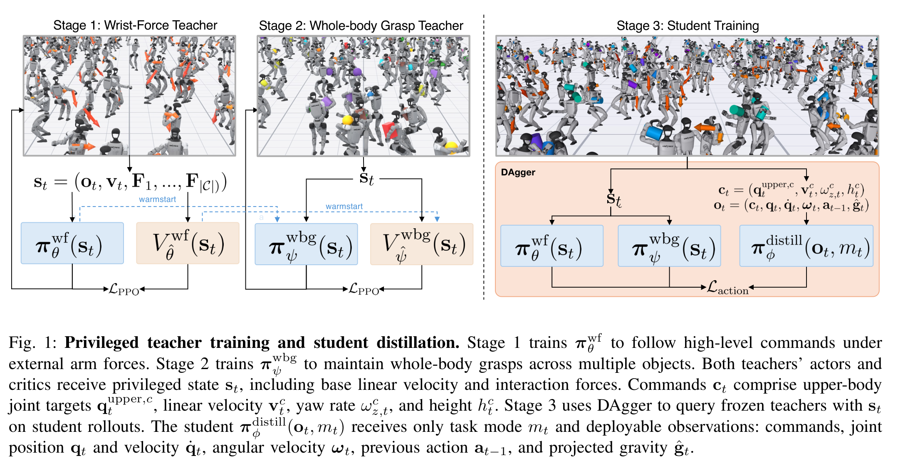

# HULK：把带负载的物理规划，教给只读本体状态的策略

> **简短说明**：HULK 用考虑外部接触力的 MPC 和捕获点约束训练特权教师，再蒸馏成不需要力传感输入的学生。300 kg 是可推动滚轮车的质量，不是举起重量；真机 5/6、4/4 等成功次数是在另一组固定负载下测得，不能与最大负载混用。

**阅读范围**：Contact-Rich Loco-Manipulation Workshop Spotlight；公开 PDF 5 页，正文与参考文献已通读，无附录，未审代码。阅读日期：2026-11-17。

**评测先看**：仿真教师最大抵抗推力从 MPC 版 110 N 到加 CP-CBF 的 130 N；真机蒸馏学生在固定负载下推车 5/6、搬载/冰箱/桶各 4/4。最大负载扫描另报推车 300 kg、载荷 12.25 kg；小样本不足以推出可靠率已接近 100%。

## 1. 问题：持续抱着重物，与被短暂推一下不同

[原文] 上肢持续受力改变了全身质心、角动量和足底支撑需求。以空载运动模仿为主的控制策略，未必能在搬东西、拉车时保持平衡。HULK 要让人形根据高层运动命令，在持续负载和推力下执行全身动作。[§I–II]

输入包括速度、高度、躯干/上肢命令和本体观测；输出是底层控制动作。它不从图像决定抓哪件物品，也不证明可以自动取得任意物体的抓握。整物体教师训练从已建立抓握的状态开始，避免把保持抓握与主动抓取混为一谈。

## 2. 思路：物理规划负责提供训练目标，策略负责运行

[原文] 本文结合 centroidal MPC reward guidance、力感知支撑/捕获点建模，以及特权教师→DAgger 学生。比较对象包括 Thor、AMO、FALCON。[§II–III]

[推断] MPC 可以显式考虑接触力矩与支撑约束，但部署时可能缺少可靠外力观测或计算资源；RL 能快速执行，却容易只学到训练负载下的经验补偿。把规划轨迹变成教师奖励，再把教师行为蒸馏给只看可部署状态的学生，是把物理结构转移到策略中的一种路径。替代是在线 MPC 或 CBF 安全滤波，约束可实时检查，却需要另行处理估计与时延。本文的学生部署没有这种在线保证。

## 3. 方法：从腕部力到整物体，再到学生

### 数据谱系与三阶段训练

| 阶段 | 数据/扰动 | 学习目标与输入 |
|---|---|---|
| 腕力教师 | BONES-RP1 252 动作、48k 重定向帧；上肢静态目标；水平 ±40 N、竖直 −50 到 5 N，各轴有 0.25 概率置零，持续 3–5 s | 课程学习持续力；教师/critic 可见 base 线速度、交互力等特权状态 |
| 全身抓握教师 | 约 130k 离线优化抓握、不同物体几何；从腕力教师 warm start | 保持已有抓握，MPC 考虑接触摩擦和力 |
| 学生蒸馏 | 在学生 rollout 上查询冻结教师，DAgger | 学生只见命令、关节位置/速度、角速度、前次动作、投影重力、任务模式；不输入真实外力 |

[原文] §III、Fig.1。没有报告足够的训练 GPU·小时、硬件控制频率和全部试验时长，复现预算不能由帧数直接推算。

### MPC 给出的不是最终执行动作

Centroidal state 为 `x=(c, Θ, l, κ)∈R¹²`，分别表示质心、基座姿态、线动量和角动量。腕力问题有两脚的 12 维 wrench 与双腕 6 维力，共 18 维输入。线性化模型、固定步态计划与摩擦约束构成凸规划，输出参考接触力、质心和骨盆姿态；教师奖励鼓励逼近这些参考。[Eqs.1–5]

外力会改变支撑需求：相同力作用在更高的位置，产生更大倾倒力矩。力感知落脚修正与约 `height×force/(mass×g)` 有关。普通捕获点 `ξ = c_xy + ċ_xy / √(g/z)` 根据质心位置与速度估计需把支撑放在哪里；本文加入外部 wrench 修正，再用 CP-CBF 约束可容许的偏离。[§III-C–D]

[推断·教学算例] 若 z=0.8 m、水平质心速度 0.2 m/s，则速度造成的捕获点偏移约 `0.2/√(9.81/0.8)=0.057 m`。即使质心投影仍在脚内，运动状态也可能要求约 5.7 cm 的额外支撑余量；负载力矩还会继续改变这个量。数值是解释算例，不是论文机器人配置。

**MPC 与 CP-CBF 用于教师训练过程；蒸馏学生不在每步运行在线 MPC/CBF 滤波。** 训练里满足或鼓励的约束，不自动成为真机学生的形式化安全保证。[§III-E]

## 4. 证据：教师、学生，固定载荷、最大载荷要分别记

### 仿真证据表

固定已训练策略、五个**评测种子**，不是五次独立训练。负载评测将每臂 10 kg 加在前臂中段，2 秒加载、2 秒稳定，再给速度/高度命令；推力评测 90 episodes，六档 50–130 N、三个方向、1 秒推力。[§IV、Table I，p.4]

| 教师方法 | 前向/侧向速度误差 | 最差 DCM margin | 躯干倾角 | 最大抗推 |
|---|---|---|---|---|
| Thor | 0.263 / 0.265 | −0.275 | 23.17° | 80 N |
| AMO | 0.276 / 0.350 | −0.705 | 9.94° | 50 N |
| FALCON | 0.367 / 0.369 | −0.329 | 7.91° | 80 N |
| HULK MPC | 0.242 / 0.257 | −0.251 | 5.90° | 110 N |
| HULK MPC + CP-CBF | 0.210 / 0.142 | −0.162 | 5.59° | 130 N |

原表含各指标的种子误差项，见 Table I；这里提取中心值，不把其当成真机 SR。按显示值，最差 DCM 越界量从 0.251 降至 0.162，约降低 35.5%；摘要写 35.7%，可能与未四舍五入值有关，但不能自行确认。yaw 误差 AMO 0.196、HULK+CBF 0.197，不是每个指标都第一。

### ID / OOD 证据表

| 维度 | 证据 | 可支持范围 |
|---|---|---|
| 受力位置 | 腕部力训练，前臂中段负载评测 | 有限接触位置迁移；不能推出任意身体接触 |
| 仿真→真实 | 蒸馏学生直接上 G1，未真机微调 | 控制迁移；不是视觉任务自主迁移 |
| 物体几何/负载 | 多物体抓握训练，真机四项负载任务与最大值扫描 | 未列严格训练外物体分层 ID/OOD SR |
| 新语言、长期规划、主动抓取 | 不在所报告接口中 | 未报告；ID→OOD 下降不可计算 |

### 真机证据表：固定负载与次数

| 固定评测条件 | HULK 成功/次数 · Wilson 95% | AMO | Thor | FALCON |
|---|---|---|---|---|
| 150 kg 滚轮车 | 5/6 · {{ci:5/6}} | 0/6 | 2/6 | 3/6 |
| 搬载 11 kg | 4/4 · {{ci:4/4}} | 4/4 | 2/4 | 0/4 |
| 冰箱任务 6 kg | 4/4 · {{ci:4/4}} | 2/4 | 0/4 | 0/4 |
| 桶 5 kg | 4/4 · {{ci:4/4}} | 0/4 | 0/4 | 0/4 |

[原文] Table II，p.4。成功条件包括不跌倒、不触发保护停机、不掉落；搬载还用 OptiTrack 测路径偏差，阈值细节未完整给出。区间为阅读者计算，4/4 的下界只有约 51%，体现小样本不确定性。

最大负载是另一组扫描：HULK 的滚轮车 300 kg、搬载 12.25 kg、冰箱 7 kg、桶 6.1 kg。这里未给上述相同次数，**不能写“300 kg 推车成功 5/6”**，也不能把滚动质量解释为举升重量。130 N 是仿真教师最大抗推，不是这张真机表的学生保证。

| 主张 | 机制/证据 | 未排除的解释 |
|---|---|---|
| 力感知规划改善持续负载控制 | 教师 MPC/CP-CBF 比较、DCM 与倾角 | 约束权重、教师优化与蒸馏损失各自贡献 |
| 学生能移除特权力输入 | 本体状态学生真机四任务 | 未给教师→学生全面误差与极端分布退化 |
| 较强的负载能力 | 固定载荷对比与最大负载扫描 | 各任务接触、摩擦、路径、试验数量对最大值影响 |

## 5. 反例与一周实验

[推断] 最强贡献是把外力与负载结构纳入教师学习，并证明可蒸馏到真机。脆弱假设是本体历史足以间接识别当前负载状态。反例：质量相同、但握持点或力臂突然改变，合力类似、倾倒力矩不同，学生可能来不及辨识。

[猜测/待验证] 固定物体质量，扫描负载到身体的力臂、力变化速度；把 MPC 教师、加 CBF 教师及各自蒸馏学生分别评估，报告跌倒、掉落、最差 DCM、跟踪误差与反应时间。如果教师稳定、学生失效，缺口是蒸馏/观测；如果两者一起失效，则需改模型或支撑计划。这样的拆分比只提高一个最大 kg 数更能检验机制。

一周计划：第 1 天检查模型、配置和仿真依赖；第 2–3 天复现一个带腕力的简化条件；第 4–5 天固定 seed 做力臂扫描与 teacher/student 比较；第 6–7 天分析失败边界。没有现成代码或教师权重则缩小为 centroidal 模型与捕获点算例，不承诺从零训练完整 HULK。真机需要 G1、已建立的安全负载工装与保护设施，不能把最大负载测试当作默认一周实验。

## 面试口述版

HULK 关注持续抱重物或推拉时的人形平衡。它先让能看到真实交互力的教师，用考虑质心、接触力和捕获点的物理规划来学习，再用 DAgger 蒸馏给只看本体状态的学生。这样部署可以不输入特权力，也不每一步跑 MPC。

结果里最容易误读的是两个数字：300 kg 是滚轮车质量，不是举起来的重量；真机 5/6 是在 150 kg 的固定推车条件下测的，不是 300 kg。它展示了强负载能力，但也只有每项 4 或 6 次真机试验。下一步我会固定质量、改变力臂，分别比较教师和学生，检查物理约束的好处有没有在蒸馏后保留下来。

## 来源与修订

- [官方 Workshop PDF](https://contact-rich-loco-manipulation.github.io/papers/15-hulk.pdf)：§III–IV、Figures 1–3、Tables I–II。
- [官方 Workshop 议程](https://contact-rich-loco-manipulation.github.io/program/index.html)：Spotlight 身份。
- 算例、Wilson 区间、DCM 比例计算与实验设计为阅读者补充；2026-11-17 初稿。
