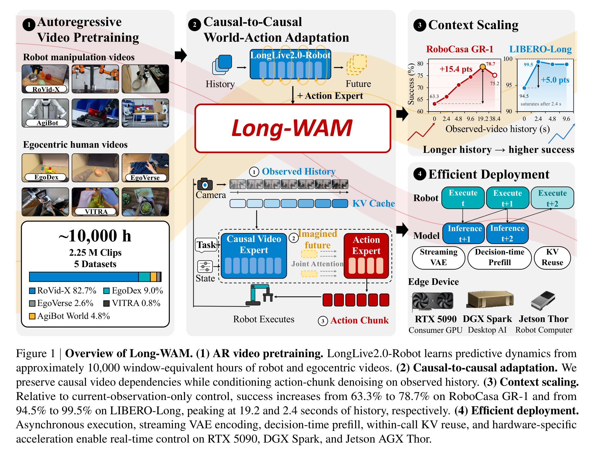

# Long-WAM：长历史与短预测，怎样一起变成动作？

> **简短说明**：Long-WAM 把机器人自回归视频先验、长历史和部分去噪的未来 latent 接给动作专家。主要价值是动态操作与时间上下文；19.2 秒历史并不总是越长越好，81.8 ms 也对应不同的精度预算。它是源页的相关延伸阅读，本次未核实 CoRL 录用归属。

**阅读范围**：arXiv:2610.10528v1，2026-10-07，28 页，含 pp.17–28 附录，已通读。原文核验，未审代码。阅读日期：2026-11-17。

**评测先看**：LIBERO 均值 99.5%；RoboTwin 2.0 均值 94.4%；G1 动态杯抓取从低速 20/20 到 7.5 cm/s 的 18/20；YAM 三项长操作各 16/20、16/20、17/20。RoboCasa 未见组合任务 6.1%，加 GPT-6 Astra 规划后 35.0%；规划器额外计算和动作修正必须计入。训练外记忆、跨会话记忆未证明。

## 1. 问题：同一张画面，可能处在不同任务阶段

[原文] 对移动中的杯子，当前图像不能充分表达速度；对长序列操作，相同的桌面布置可能对应“还没做”或“已经做过”。短观察窗口和逐块动作生成会丢失这些时间信息。论文研究如何让 WAM 同时读取更长的过去并形成短期未来预测，以改善动作决策。[§1、3]

输入是视频历史、本体状态和语言，输出是未来动作块。成功不仅是离线预测合理，还要在真实推理延迟下持续完成动态、长程任务。长上下文本身不等于会利用历史，生成长视频也不等于机器人需要解码完整 RGB 电影。

## 2. 思路：长上下文首先需要合适的预训练先验

[原文] LongLive2.0 提供自回归视频初始化；作者继续做机器人视频预训练，再接动作专家。FastWAM 路径强调直接动作；本文保留部分未来 latent 作为条件。[§2–3]

[推断] 如果视频骨干擅长的只是短片双向去噪，直接增加历史帧未必得到稳定时间推理。因果视频训练让“过去→未来”成为预训练任务，再让动作读取这个表示，逻辑上更匹配闭环控制。替代方案是外接显式状态记忆或只用动作历史；这可能更省延迟，但需要证明压缩没有丢掉任务阶段。本文并未排除这些方案。

## 3. 方法：历史、未来 latent、动作，分别做什么？

### 数据谱系与预算

| 数据/阶段 | 规模与来源 | 训练用途与边界 |
|---|---|---|
| 机器人视频 | RoVidX 1,898,562；AgiBot 两子集 69,834 + 40,497；EgoDex 207,044；EgoVerse 59,742；VITRA 19,210 个窗口 | 合计 2,294,889；train/val/test = 2,251,021/21,931/21,937 |
| 视频时长 | 10,004.5 小时 | 按训练窗口数 × 16 秒换算；不是已证明去重的原始录像总时长 |
| 视频继续预训练 | 64 H100，约 30,720 H100 GPU·小时 | actionless 自回归视频学习；非一周可从头复现预算 |
| WAM 训练 | 16 GB200 | 动作数据按 benchmark 配方；各真实任务示范数未完整报告 |

[原文] App.B.1，p.17；§3。五个数据家族含六个子集，不能把两份 AgiBot 算成两个完全独立数据家族。

### 两遍训练，使视频先验与动作监督分工明确

第一遍训练视频 flow matching，使用 block-causal attention、teacher forcing 和 error recycling。第二遍训练动作专家，读取**停止梯度的**视频缓存；动作损失更新动作专家与本体适配器，不回传去改视频专家。视频 token 不读取动作，动作读取历史、部分未来视频及动作块。[§3]

用抓移动杯子贯穿：历史给出杯子的运动与机械臂过去状态；视频专家形成将来的 latent；动作专家据此生成抓取轨迹。推理时从高斯噪声开始，只将未来 latent 去噪到 σ*=0.9，默认视频 4 步、动作 4 步，不需要解码未来 RGB。训练条件则来自真实未来视频的加噪 latent；因此不能把训练和推理条件分布说成完全一样。

每个历史长度的策略单独训练，不是同一 checkpoint 免费变长。零历史仍有当前帧；序列开头用第一帧补齐，38.4 秒设置中填充占 80.4%，有可能削弱长历史的有效信息。[§4–5、附录]

### 异步执行的算例

设现有动作块剩 R 步，新块偏移 S 步，控制步长 Δt，可用于计算的重叠时间为 `(R−S)Δt`。新块必须在 `T_ready ≤ (R−S)Δt` 内准备好。[Eq.4]

[推断·教学算例] R=24、S=16、20 Hz 时，8 步重叠提供 0.4 秒。若模型耗时 341 ms，剩余约 59 ms 才能给数据搬运和调度；这不是实测端到端保证。缓存可在一次推理内部复用，但机器人状态、位置编码和历史改变后，跨决策不能直接沿用所有 KV。

### 延迟数字如何对应精度？

| 配置 | 耗时 | RoboTwin SR | 注意 |
|---|---|---|---|
| BF16 基础配置 | 356 ms | 94.4% | Table 6 |
| 优化 V4/A4 | 107.4 ms | 93.5% | 视频 NVFP4、动作/KV BF16，编译/CUDA graphs 等 |
| 优化 V2/A2 | 81.8 ms | 92.5% | 更少去噪步，不能同时引用 94.4% |
| 历史 0/2.4/4.8/9.6/19.2 s | 74.6/107.4/138.3/204.5/341.0 ms | 不在此行跨设置拼接 | App.G p.21，长历史有显著成本 |

[原文] App.F：两次进程运行，各 5 次 warmup、30 次稳态，汇总 median；测量包括 VAE/模型推理，排除预处理、文本编码、控制器 IPC，不是 sensor-to-motor 全链延迟。

## 4. 证据：把上下文、预测与系统优化分开

### 仿真证据表

| 基准与协议 | Long-WAM | 对照/支持范围 |
|---|---|---|
| LIBERO | 平均 99.5%，Long 子集 99.5% | 无未来预测 94.5%；CoD 表内 Long 95.8%；原文 §5.3 的 97.8% 与表不一致，97.8 是 CoD 均值 |
| GR-1 记忆 | 摘要零历史 63.3% → 19.2 s 78.7%；38.4 s 75.2% | 2.4 s：正文 66.3%，Table 4 63.3%，保留冲突；不能擅自调和 |
| RoboTwin 2.0 | clean 94.7%，randomized 94.2%，均值 94.4% | ABot 94.1%、LingBot-VLA 2.0 93.6%；原生预算不完全匹配 |
| DOMINO，动态微调后 | SR 34.9%，MS 45.1% | FastWAM SR 19.9%；不是动态环境零样本测试 |
| RoboCasa365，50 任务 | 单模型均值 31.4%；加 planner 54.4% | 分任务类型见下表；额外 GPT-6 Astra 调用及动作修正 |

[原文] Tables 1–5，pp.7–9。机器人 AR 预训练与非机器人 AR、双向 Wan2.2 的比较支持先验选择，但预训练数据和预算并非全面等量，不能把全部差距归因于因果注意力。

### ID / OOD 证据表

| 维度 | 无 planner | 加 planner | 可以怎样解释 |
|---|---|---|---|
| RoboCasa 18 个见过的原子任务 | 67.9% | 85.6% | 相同策略 checkpoint，系统多了规划 |
| 16 个见过的组合任务 | 15.8% | 38.8% | 多步任务难度本来不同 |
| 16 个未见的组合任务 | 6.1% | 35.0% | 有未见组合证据；不能用原子任务作为匹配 ID 去算 OOD 下降 |
| RoboTwin clean→randomized | 94.7%→94.2% | 不适用 | 差 0.5 点；未确认严格训练外随机化，避免称严格 OOD |
| 新对象/指令/本体、跨会话记忆 | 未完整分层报告 | 未报告 | 不能用长窗口替代这些结论 |

planner 提供子指令、执行前缀及有界末端修正，不只是改写一句语言。固定 15 步控制前缀也不能复现完整 planner 收益，仍需计入模型调用预算。[§5.4、Table 5]

### 真机证据表

| 硬件、任务 | 成功/次数 | SR · Wilson 95% | 同协议对照 |
|---|---|---|---|
| G1，杯子 3 cm/s | 20/20 | {{ci:20/20}} | FastWAM 15/20，π0.5 3/20 |
| G1，杯子 4.5 cm/s | 20/20 | {{ci:20/20}} | FastWAM 6/20，π0.5 0/20 |
| G1，杯子 6 cm/s | 19/20 | {{ci:19/20}} | 两对照均 0/20 |
| G1，杯子 7.5 cm/s | 18/20 | {{ci:18/20}} | 两对照均 0/20 |
| G1，动态堆叠 3 cm/s | 19/20 | {{ci:19/20}} | 两对照均 0/20 |
| YAM，积木/饺子/碗 | 16/20；16/20；17/20 | {{ci:16/20}}；{{ci:16/20}}；{{ci:17/20}} | 三任务均值 81.7%，平均时长 >40 秒 |

[原文] Figures 7–8，p.10。Wilson 为阅读者计算；真机每项训练示范量、速度是否训练外、失败恢复预算未完整给出，不据此认定严格速度 OOD。20/20 也不等于真实成功概率必然 100%。

| 主张 | 机制与实验 | 尚未排除 |
|---|---|---|
| 历史有用 | GR-1 不同窗口分别训练，19.2 s 最佳 | 填充比例、训练配方、历史内容与帧数各自影响 |
| 未来 latent 有用 | LIBERO 去除预测的消融 | 所有真实任务都需要视频预测的普遍性 |
| 可实时闭环 | 系统优化与异步表 | 全链尾延迟、不同硬件、长历史下的保证 |

## 5. 反例与一周实验

[推断] 最强贡献是把训练先验、可用历史和执行时序连起来。反例是历史里有另一个人的干扰操作或错误动作：长历史如果只增加相关但无因果的信息，可能反而妨碍当前决策。38.4 秒低于 19.2 秒已提醒我们不能简单外推长度收益。

[猜测/待验证] 固定帧数和计算量，比较正确历史、乱序历史、其他 episode 的历史和重复当前帧。选择当前画面相同、阶段不同的任务；报告阶段误判率、SR、平均/尾延迟。如果正确历史没有稳定胜出，则反驳“收益主要来自时间推理”，应转查视觉覆盖或训练预算。

一周计划：第 1 天检查公开 checkpoint 与推理依赖，记录显存；第 2 天构造阶段混淆与四种历史条件；第 3–4 天固定 checkpoint 推理；第 5 天测动作前缀与推理重叠；第 6–7 天在一个小仿真任务复核。若无可用权重，只完成数据集与缓存/时序实验，不声称复现论文。完整 30,720 H100 GPU·小时预训练不列入一周资源承诺。

与 WB-WAM 的连接是一个可检验的问题：WB 的部署不必生成未来视频，而 Long 保留部分未来 latent；两者任务、数据与预算不同，不能凭两篇结果直接判定“未来预测总是有用”或“总是多余”。

## 面试口述版

Long-WAM 要解决的是机器人只看短片段时容易忘记阶段，也不容易追上动态物体。它先把自回归视频模型继续训练到机器人视频上，让模型学会从过去预测未来，再让动作专家读取长历史和部分去噪的未来 latent。动作训练不反向改变视频缓存，部署也不需要真的解码未来视频。

它在动态抓杯和长操作上有很强的结果，但这里有三种成本：机器人视频预训练、长上下文推理和实时动作调度。19.2 秒历史在一个记忆任务上优于更短窗口，38.4 秒又下降；最快 81.8 ms 配置也牺牲了一些成功率。因此我会把它理解为有证据支持的时间上下文方案，而不是无限记忆。最值得进一步做的是固定帧数，打乱历史，检查模型到底在利用时间因果，还是仅从更多视觉样本获益。

## 来源与修订

- [Long-WAM v1](https://arxiv.org/abs/2610.10528v1)：§3–5、Tables 1–7、Figures 7–8、Appendices B/E/F/G。
- 已保留两处原文数值冲突：GR-1 的 2.4 秒结果、LIBERO-Long 的 CoD 对照。未使用代码替原文做未验证修正。
- 公式算例、Wilson 区间、反例与计划为阅读者补充。会议归属未核实；2026-11-17 初稿。
