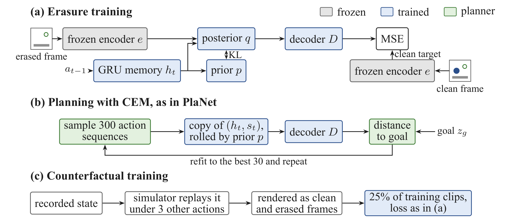

# MemJEPA：让世界模型在看不见时仍能规划

> **简短说明。** MemJEPA 用循环状态替换短窗口预测器：训练时隐藏实体，但仍预测包含实体的干净 latent；规划时每条候选动作各自推进一份状态。三个仿真任务的隐藏条件均值约 78%，匹配无记忆模型约 13%。收益对理想化擦除很强，却没有迁移到一般遮挡：移动遮挡块使 PushT 几乎全败；尚无真机结果。

核读：[Memory Workshop 官方 PDF](https://corl2026-memory.github.io/papers/051.pdf)，23 页含附录 A–N。Steven Yang，独立研究者；Workshop 论文见[官方列表](https://corl2026-memory.github.io/papers.html)。固定下载版本，未运行代码。这里的“世界模型”是动作条件 latent 动力学与 CEM 规划，不是视频生成大模型。

## ① 问题：短窗口忘掉的状态，规划器能补回来吗？

假设摄像机连续几帧看不到推杆。即使桌上的方块仍可见，推杆在哪里、下一次动作会不会碰到方块，都取决于更早的历史。LeWM 的三 latent 窗口最多覆盖 15 个环境步；一旦最早可见帧退出窗口，当前输入无法区分不同隐藏位置。

单纯加 GRU 不一定有效：训练时实体一直可见，网络可以从当前帧抄答案，从未学会保留它。MemJEPA 因而把问题变成 **训练目标是否迫使循环状态保存缺失信息**，再问保存的信息是否被候选动作规划正确利用。[§1–2](https://corl2026-memory.github.io/papers/051.pdf#page=1)

## ② 思路重建：遮住输入，还要留下可学习的目标

[推断] 先加一个 recurrent state 提供记忆容量；再移除训练中的捷径，让当前输入不包含实体。若目标也擦掉，预测背景就能低损失，记忆没有价值。因此目标必须保留干净实体。最后，规划比较的是“如果采取另一组动作会怎样”，只学习数据实际执行的动作可能不够，于是加入模拟器分支回放。

这三个因素应分别测试：**有状态但普通训练、擦除但无状态、状态加擦除训练**。论文还交换不同 episode 的状态、切断 recurrence、替换为擦除目标、增加窗口和规划候选数。这些对照比单一平均分更能定位收益；但一些是看过结果后的 post-hoc 分析，论文有明确披露。

## ③ 方法：真实状态继续积累，想象状态分支后丢弃

**训练。** 冻结 LeWM 的 ViT-Tiny 编码器 e。每段 clip 有 50% 概率保持可见，另 50% 在前两帧之后不再渲染实体：Reacher 擦掉手臂，PushT 擦掉推杆，TwoRoom 擦掉智能体。物理状态没有改变，不是在图上画一个有位置线索的黑框；测试没有本体感知输入，目标图仍给定。

RSSM 同时包含确定状态 h 与随机状态 s：

`hₜ = GRU(hₜ₋₁,[sₜ₋₁,aₜ₋₁])`；`p(sₜ|hₜ)` 是想象先验，`q(sₜ|hₜ,e(õₜ))` 用真实观测更新。解码器 D 输出的是干净图像的 **latent**，并非 RGB。

`L = Σₜ ||D(hₜ,sₜ) − e(oₜ)||² + KL(q||p)`。

输入 õ 被擦除，目标 o 没有；KL 使用 0.8 balancing 与 1 nat free bits。**微型算例**：干净 latent 的位置分量应为 0.8，当前擦除图只能支持 0.1，那么预测 0.1 的平方误差为 0.49。历史若帮助预测到 0.7，误差变成 0.01。若目标本身也变成 0.1，记住历史就不再获得这个收益。数值是教学例，不是测量值。[Appendix B/L](https://corl2026-memory.github.io/papers/051.pdf#page=8)

**部署规划。** CEM 采样 300 条动作序列，各自复制当前 (h,s)，按候选动作利用 prior 推进，解码 horizon latent，与目标 zᵍ 的平方距离评分。选前 30 个 elite 重拟合，Reacher 10 轮、另两任务 30 轮；规划 5 个动作块，每块 5 个原始步，执行完整 25 步后重规划。候选的虚拟状态丢弃，真实状态继续接收观测，不能让尝试过但没执行的未来污染记忆。

**反事实训练。** 每十个训练起点恢复一次模拟器：两条近原动作加 AR(1) 噪声的分支、一条其他 episode 的动作分支。分支生成的 clean/erased clip 替换 25% 训练抽样，更新步数不变。它需要可恢复的仿真状态，真实离线视频不能凭空提供这些分支。

**预算与替代设计。** 11 帧 clip、batch 128、5 epochs；三个独立训练 seed。MemJEPA 学习率 3e−4，匹配无记忆预测器与 GRU-belief 方案为 5e−5。Reacher 约 74–78 分钟/4090；TwoRoom 一 epoch 约 2.9 GPU 分钟，PushT 五 epochs 约 50 分钟。GRU-belief 不是主 RSSM，它在原预测器输入添加状态；其额外 imagination-consistency 项在初测后加入，在新未打开测试集上的增益区间包含 0。[Table 2、Appendices B/E](https://corl2026-memory.github.io/papers/051.pdf#page=9)

## ④ 实验：记忆收益必须放回遮挡协议里

**仿真主表：各任务 200 cases × 3 seeds，隐藏 / 可见成功率（%）。**

| 方法 | Reacher | PushT | TwoRoom |
| --- | --- | --- | --- |
| 同配方无记忆 | 7.5 / 93.8 | 3.3 / 51.7 | 29.3 / 84.3 |
| RSSM，普通可见训练 | 8.5 / 94.2 | 7.8 / 74.3 | 27.8 / 81.0 |
| 10 帧窗口 | 74.0 / 94.7 | 32.5 / 74.7 | 78.0 / 82.7 |
| GRU belief | 93.0 / 94.7 | 52.0 / 78.8 | 79.0 / 83.8 |
| MemJEPA | 93.2 / 93.0 | 57.0 / 72.0 | 83.3 / 87.0 |

来源 Table 1。三任务均值约 77.8 对 13.4 是任务均值，不是通用机器人成功率。作者用成对、case/episode 聚类 bootstrap；Reacher 同一 episode 的两个 case 一起重采样。不能将 600 次简单当成完全独立试次来取代这些区间。TwoRoom 主表是已评估过的集合再次测试；Appendix H 的新集合复核了主记忆差异。

**最有解释力的反例与消融。**

| 对照 / 数据集 | 结果 | 解读 |
| --- | --- | --- |
| PushT 开发集：目标也擦掉 | RSSM 9.0%，干净目标 42.0% | 容量与遮挡本身不够，目标内容重要 |
| 首次决策交换历史状态 | MemJEPA 三任务 7.2 / 2.8 / 21.2% | 历史状态被使用；与旧 baseline 的 GPU/框架不同，只作描述比较 |
| 新 PushT 集反事实分支 | 54.2→65.1%，+10.9 点，95% 配对区间 [7.3,14.6] | 300 cases ×3 seeds；不能把增益加到主表 57.0 上 |
| 新 Reacher / TwoRoom 加分支 | +1.2 / 0.0 点 | 一项任务上的增益不支持普遍机制结论 |
| 新 Reacher：开环无记忆预测器 | 578/600=96.3%；MemJEPA 569/600=94.8% | 已知动作足以推演时，循环记忆并非必要 |
| 新 PushT：开环 / MemJEPA | 207/900=23.0% / 488/900=54.2% | 但开环方案也丢弃可见方块反馈；差异包含这个设计劣势 |
| TwoRoom：循环 BC / MemJEPA | 95.3 / 85.2% | 有近专家数据时，更简单的循环策略更强 |

来源 Appendices E/G/H/I/K。无记忆增加到 1200 个 CEM 候选仍弱；一次重规划耗时约 277.4 ms（无记忆）、303.3 ms（GRU belief）、129.7 ms（MemJEPA），RTX4090、300 候选。它比较不同预测架构的一次规划，不是同构模型只多了记忆后的纯加速。

**ID/OOD：按遮挡、时长、骨干分开。**

| 变化轴 | ID / 参考条件 | 变化后的条件 | 结论 |
| --- | --- | --- | --- |
| 隐藏时长，PushT span 集 | 隐藏 2 帧 61.7% | 40 帧 10.2%；加分支 15.0% | 长遮挡仍失败；前缀动作幅度也改变，不能纯归因时长 |
| 未训练移动遮挡块，Reacher | 无块 577/600=96.2% | 有块 68/600=11.3% | 没有一般遮挡鲁棒性 |
| 移动遮挡块，PushT 开发集 | 无块 208/300=69.3% | 有块 1/300=0.3% | 分支训练也未修复 |
| TwoRoom 区域遮挡 | 可见 198/213=93.0% | 遮挡 29/213=13.6% | 66/71 cases 先前从未见实体，不能要求记忆回忆未知状态 |
| 换 DINO-WM 骨干 | 对照可见成功率 | MemJEPA 可见下降 15.2–32.3 点 | “不损伤可见表现”只在主要 LeWM 设置成立 |

**真机证据。**

| 任务 / 本体 | 数据与试次 | 目前能说什么 |
| --- | --- | --- |
| 真机操控 | 未进行 | 不能称为真实遮挡控制已解决 |
| 隐藏被操作物、保留机械臂可见 | 已设计但未运行 | 论文实际隐藏的是被控制身体；现实中可能有本体感知替代 |

理论 Appendix L 的条件期望分解说明：用完整历史可降低的最优预测误差，等于历史条件均值在短窗口下的条件方差。这是必要信息差的说明，**不保证有限网络会学到，也不保证 CEM 用得好**。

## ⑤ 攻击与延伸：先测试真实缺失信息，再扩展模型

最重要的未闭合处是任务现实性：擦掉机械臂却不给关节状态，是受控实验；现实更重要的是看不见的外部物体。Reacher 的本体状态 oracle 与开环滚动已能接近 MemJEPA，说明大幅超越短窗口基线并不等于记忆独有收益。

[待验证] 最小实验应保留机器人本体状态，遮住被推动方块，并安排接触后的外力扰动。比较循环 BC、开环预测、带实时可见反馈的滤波器和 MemJEPA；统一编码器、训练数据与规划预算。训练遮挡与测试遮挡分开采样，报告“曾经见过”和“从未见过”两层；隐藏时长实验固定动作幅度，才能隔离记忆衰减。

[推断：对 WB-WAM 的用途] 可以在动作条件 latent 上测试“缺失观测→干净目标”的辅助训练，但真实数据的干净对应目标与仿真反事实不是免费资源。先在可控仿真验证接触后的状态估计，再讨论接入大模型；不要把隐藏状态均值当成校准的不确定度，论文的 energy-score 变体没有获得可靠 coverage，也未提高规划表现。

## 面试口述版

MemJEPA 给我的启发是，记忆模块需要一个非记不可的学习任务。它把实体从训练输入里擦掉，却要求预测包含实体的干净特征，迫使循环状态保留历史；规划时每个候选动作都推进自己的状态副本。这个设计在理想化隐藏实验里很强，但附录很关键：动作可确定推演的任务，开环预测已足够；真实感更强的移动遮挡又让模型失败。所以我会把它当作记忆训练机制的受控证据，再用隐藏外物、保留本体感知的实验验证是否对真实机器人有用。

## 证据索引与未覆盖项

全文 23 页核读。主机制 Fig.2 / Appendix B；主表及统计 A–C；窗口和状态对照 D–E；骨干迁移 F；分支 G；独立集合 H；BC I；长遮挡 J；现实性对照 K；理论 L；限制 M；相关工作 N。本文保留作者的负结果和 post-hoc 标记，未将模型训练曲线或潜在状态可解码性替代控制成功。原图版权归作者。
