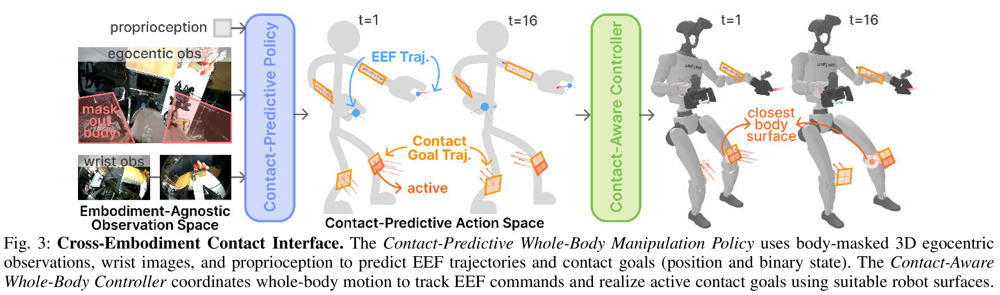
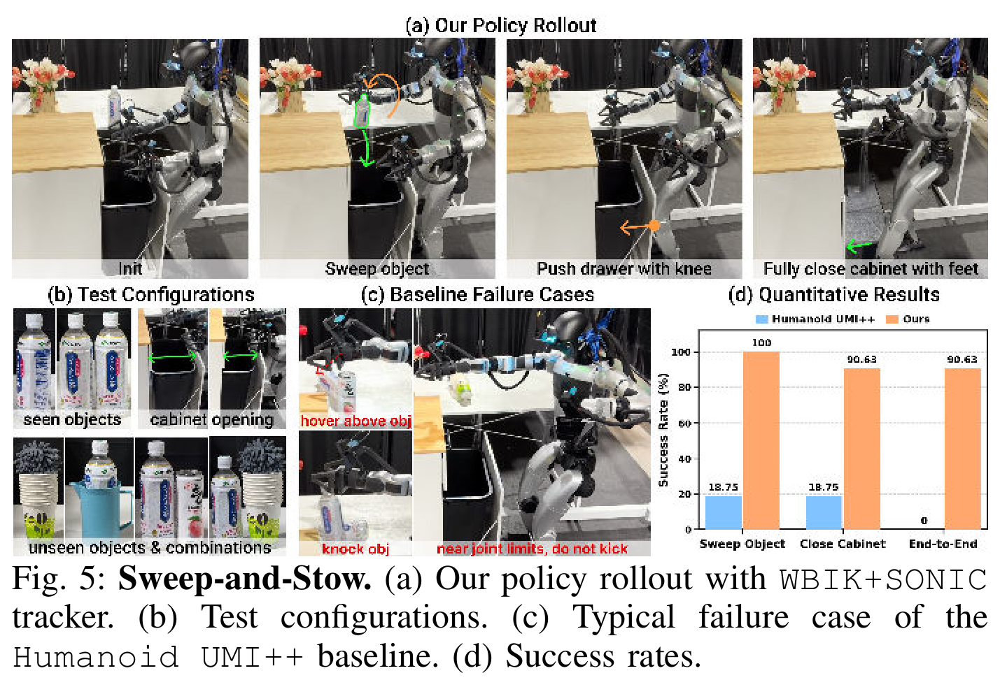

# PanTact：让人形模仿接触目标，而不必复制人的每个关节

> **简短说明**：PanTact 用人佩戴的触觉贴片记录“什么时候、哪里发生身体接触”，让策略预测末端动作和接触目标，再由控制器选择机器人合适的身体表面实现。它展示了不追加机器人示范的接触操作迁移；扫物入柜的 90.63% 含部分得分，不能写成完整成功次数。

**阅读范围**：Contact-Rich Loco-Manipulation Workshop Spotlight，官方公开 PDF 9 页，含 pp.7–9 附录，已通读。PDF 未给明确版本号；下载/阅读 2026-11-17。论文匿名版，作者名单以官方 Workshop 议程为准；未推断机构，未审代码。

**评测先看**：G1 抓取并怀抱，上身 IK 17/20、稀疏跟踪器 16/20；搬箱并推箱，全身 IK 9/10、稀疏跟踪器 6/10。仿真主要测参考回放跟踪，未给可直接并列的完整视觉任务成功率；未见对象测试未分层报告 ID/OOD 成功率。

## 1. 问题：抱住箱子时，手的位置不足以描述任务

[原文] 人把物体夹在前臂和躯干之间，或用膝盖推箱子，任务依赖的是身体与物体的接触。只记录两只手的末端轨迹会漏掉这些约束；完整重定向人体姿态又可能强迫机器人复制并不必要、甚至不可行的关节配置。[§I–II]

具体例子是“一边抱着箱子，一边用身体推走地上的另一个箱子”：输入为第一视角/腕部视觉与本体状态；输出既要安排手，也要指出哪些世界位置需要接触。成功判据是稳住怀中箱子，同时让地面箱子移动超过 20 cm，而不是单纯跟得像人。

## 2. 思路：哪些信息是跨身体保留的？

[原文] 本文承接 UMI/Humanoid UMI 的无机器人示范，以及 HoMI 的三维第一视角表示；它增加身体触觉记录，并把控制目标从固定 link 轨迹扩展为接触位置。[§II–IV]

[推断] “物体这里需要被支撑”比“人的某个前臂关节要转多少度”更接近任务不变量。先描述接触，再让机器人自由选择身体表面，可以减少形态差异。然而身体表面可达不代表摩擦、接触力和力矩都可行。合理替代是密集全身动作跟踪：它保留更多姿态先验，遇到精确姿态很重要的任务可能更可靠；本文自己的 WBIK 与稀疏跟踪对比也没有证明稀疏表示处处最好。

## 3. 方法：采到触觉，最终却不要求机器人装同样的贴片

### 数据谱系

| 信号 | 采集/频率 | 进入模型的形式 |
|---|---|---|
| 身体接触 | 44×44 mm FSR 模块；16 通道 PCB，1 kHz | 每贴片接触开关 c 与 3D 位置 p；力强度被记录，但策略用二值接触，不是校准力指令 |
| 视觉 | 头戴双目、双腕鱼眼，60 fps | 三维 ego 表示及腕部图像；掩去人体区域 |
| 位姿/夹爪 | Vive 头/腕 250 Hz，夹爪 1 kHz | 对齐至 60 Hz，再按 20 Hz 训练；观察历史 2 步 |
| 三任务人类示范 | 抓抱 100；扫物入柜 150；搬运推箱 110 条 | 未追加机器人示范；不等于没有传感器、控制器训练或人类标注成本 |

[原文] §III、App.VII–IX，pp.2、7–9。自适应接触阈值基准 0.35，属于信号处理参数，不是物理牛顿值。

### 从观察到预测

策略每步动作包括头部 3D look-at、左右末端位姿和夹爪宽度，以及 N 个 `(接触开关, 接触位置)`，每贴片四个量。观察和动作统一到**最新左夹爪位姿**定义的坐标系；部署再用 LiDAR–IMU 的 SuperOdometry 变换到世界坐标。[§III]

身体遮挡通过三维半空间近似并从 ego 视觉注意力中屏蔽，减少人的身体外观与机器人身体外观差异。DINOv3 视觉编码器参与微调，动作 DiT 为 10 层、宽 768、12 heads，训练 500 epochs、batch 48。扩散训练 100 步，推理 16 次 DDIM；策略 10 Hz 产生 H=16 的动作块，再异步重采样到 50 Hz，过期命令按时间戳跳过。[§III-B、附录]

### 接触目标如何变成机器人动作？

令 `d_b(p,q)` 为目标点 p 到机器人第 b 个候选身体表面的距离；控制器用平滑最小值：`d(p,q)=−T log Σ_b exp(−d_b/T)`，T=0.02 m。只对预测为 active 的接触追踪；inactive 不要求机器人复制贴片在空中的轨迹。[§IV-A]

[推断·教学算例] 目标点离前臂表面 2 cm、离腕部 10 cm，softmin 约 1.96 cm，梯度主要推动较近的前臂接近目标。它没有直接计算需要多少牛顿。论文通过把虚拟目标放到物体内部，让跟踪误差产生按压力；实际力仍取决于控制增益、物体几何与刚度。机器人端没有额外身体触觉贴片闭环。

三种执行器分别是：上半身 IK；全身 IK 生成密集参考后交 SONIC；训练一个直接跟踪稀疏末端/接触目标的 RL 策略。稀疏控制器在 50 Hz 生成 29 关节目标，由 PD 执行；训练用 hindsight 接触标签，4096 环境、30k PPO iterations。训练的软接近奖励与部署时仅追踪 active 目标需区分。[§IV-B、App.VIII]

## 4. 证据：接触信息有效，不等于所有控制器一样好

### 仿真证据表

| 实验 | 数量/指标 | 可支持范围 |
|---|---|---|
| 参考回放控制评估 | 10 条上身、20 条全身轨迹；距离误差采用 median-of-medians | 控制接口的跟踪质量，不是闭环视觉任务 SR |
| 稀疏控制器训练 | 仿真 PPO 与参考/接触奖励 | 论文公开版本有未解析的图号引用，无法补出未展示的数值曲线；不编造仿真任务成功率 |

### ID / OOD 证据表

| 维度 | 设置 | 报告结果/边界 |
|---|---|---|
| 对象与数量 | 扫物入柜：见过/未见对象 × 单/双对象，4 条件各 4 次 | 总计 16 次，但未分层列四组成功率；ID→OOD 下降不可算 |
| 空间配置 | 搬箱推箱，地面箱左右各 5 次 | 合并 10 次；不是完整新场景测试 |
| 跨本体 | 人类采集→G1 执行，无额外机器人示范 | 仅一个目标机器人；不能说已验证跨多个机器人零样本 |
| 指令、长时序、摩擦/负载 | 未做完整分层评测 | 未报告 |

### 真机证据表

| G1 任务 | 本文方法 | 对照 | 指标解释 |
|---|---|---|---|
| 抓取并怀抱，20 次 | 上身 IK 17/20，{{ci:17/20}}；稀疏 16/20，{{ci:16/20}} | Humanoid UMI 0/20 | 二项完整任务成功 |
| 扫物、关柜并收纳，16 次 | 扫物 100%，关柜 90.63%，最终 90.63% | Humanoid UMI++ 最终 0% | 扫物按物体比例，关柜含 50% 部分得分，最终取乘积；不能转成成功次数或 Wilson |
| 抱箱并推箱 >20 cm，10 次 | WBIK 9/10，{{ci:9/10}}；稀疏 6/10，{{ci:6/10}} | Humanoid UMI++ 4/10 | 小样本；控制器选择显著影响结果 |

[原文] Figures 4–6，p.4；App.VII，p.7。Wilson 区间为阅读者计算。扫物收纳图虽然以 success rate 标注，附录评分包含部分得分，本页按**平均任务分数**解释。

| 主张 | 支持证据 | 边界 |
|---|---|---|
| 接触接口能迁移人类示范 | 三类 G1 任务、无追加机器人示范 | 依赖专门采集装置、视觉掩码、里程计及控制器 |
| 无需复制全身姿态 | 稀疏接触控制可完成任务 | 搬运任务 6/10 低于 WBIK 9/10，不是统一优势 |
| 可以实现身体接触 | 前臂/膝等操作展示 | 没有直接力闭环，未证明摩擦/刚度突变鲁棒性 |

失败包括漏掉小物体、怀中箱子滑落、关柜不完全；控制器可能优先平衡而放弃手部目标。稀疏目标带来自由度，也放大接触预测和执行质量的重要性。[§V、附录]

## 5. 反例与一周实验

[推断] 最强贡献是把接触意图变成可学习、可执行的中间接口。反例是外观不变但表面变滑：接触点仍预测正确，虚拟目标产生的压力却不足，箱子会滑落。仅用接触位置不能区分“轻碰”“支撑”和“用力推”。

[猜测/待验证] 固定视觉策略和控制器，对比接触目标开启/关闭，再在同一物体上改变摩擦或负载，记录 SR、滑移、实际接触力和错误接触率。若接触接口只在训练摩擦下有效，则反驳“接触位置足以承担主要物理泛化”的强版本；新增力反馈若恢复表现，可定位缺口在执行闭环。

一周计划：先核对公开模型与装置实现，选择单前臂支撑的小任务；第 1–2 天校验阈值和时间同步，第 3–4 天离线重放接触目标，第 5 天固定控制器做消融，第 6–7 天在已有 G1/安全设施条件下做匹配试验。若没有采集装置或平台，则只做仿真接触目标接口；不承诺一周从零复制整套硬件。FSR/Vive/相机、定位、控制权重的可获得性本次未审计。

## 面试口述版

PanTact 研究的是人形怎么从人的示范学会用身体接触物体。只模仿两只手会漏掉抱箱子时的前臂支撑，复制整个人体又可能约束过多。所以它让人佩戴触觉贴片，记录何时、何处需要接触；策略预测末端轨迹和接触目标，机器人控制器再找合适的身体表面实现。

它在 G1 上不用追加机器人示范就完成了抓抱、扫物入柜、搬箱推箱。但不能把它说成触觉闭环力控：触觉主要用在采集端，机器人靠预测位置与控制误差产生接触力。而且不同控制器的表现差别很大，搬箱推箱全身 IK 是 9/10，稀疏控制是 6/10。下一步我会在相同接触几何下改摩擦和负载，验证位置接口什么时候需要增加力反馈。

## 来源与修订

- [官方 Workshop 论文 PDF](https://contact-rich-loco-manipulation.github.io/papers/28-pantact.pdf)，§III–V、Figures 3–6、Appendices VII–IX。
- [官方 Workshop 议程](https://contact-rich-loco-manipulation.github.io/program/index.html)：Spotlight 身份与作者信息。
- 算例、Wilson 区间、反例和计划为阅读者补充；2026-11-17 初稿。
