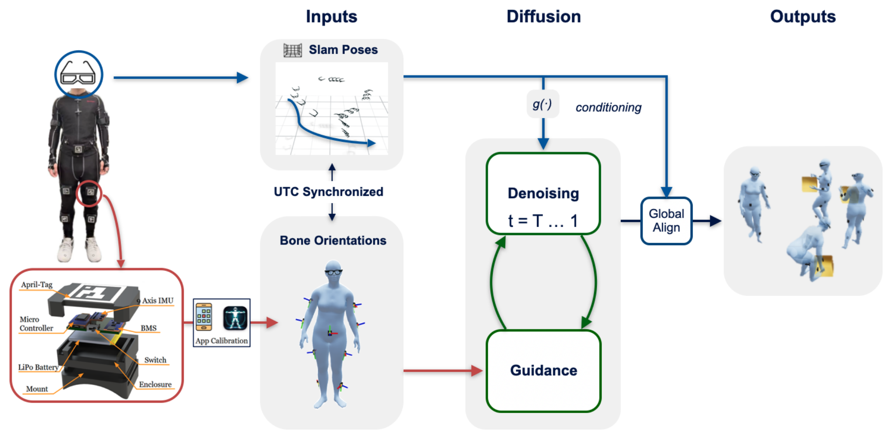

# RoSHI：先把人类动作采准，再谈跨本体学习

> 简短说明：RoSHI 把九个低价 IMU 与 Aria 眼镜结合，用惯性方向约束人体姿态、用 SLAM 稳定全局轨迹。它解决人类数据的采集接口，提供可重定向到 G1 的动作；本文没有证明大规模人类数据已经提升下游通用策略。

## 1. 问题与关键判断

人类动作迁移需要三份同步信息：身体怎么动、整个人在世界中去了哪里、当时看到什么。单独优化一帧的人体网格误差，不能保证一段轨迹适合机器人模仿。RoSHI 的选择是让传感器各自负责更可靠的部分。（PDF pp.1–3）

外部相机依赖可见性与标定；IMU 在遮挡和快速运动时仍能感知旋转，却不能稳定提供全局平移；第一视角 SLAM 提供米制轨迹，但看不到身体的多数关节。RoSHI 用稀疏 IMU 补足姿态约束，再让 EgoAllo 的人体先验补出未测自由度。这里的 diffusion 是**人体运动重建器**，不是直接输出机器人动作的策略。

## 2. 数据从哪里来，监督到了哪里

需要分开采集硬件、人体先验和机器人训练三个阶段；“低成本采集”不等于免预训练，也不等于免标定。（§III–IV）

| 环节 | 输入、来源与用途 | 边界 |
|---|---|---|
| 原始采集 | 九个 BNO085 IMU，双臂、双腿各两个，骨盆一个；100 Hz 方向数据；Aria 约 30 Hz RGB 与 SLAM | 论文约 350 美元是九 IMU 加接收器，不包含 Aria、手机与工作站 |
| 初始标定 | 手机拍 20–40 秒自然动作；外壳 4 cm AprilTag 给传感器方向，SAM 3D Body 给骨骼方向 | 不用固定 T-pose，但仍用外部手机完成标定 |
| 人体重建 | EgoAllo 在 AMASS 与合成头戴轨迹上训练；推理时增加骨骼方向 guidance | 未直接测到的关节仍依赖先验 |
| 定量数据 | 两名采集者、11 段动作；三组分别强调原地、全局位移、快速运动 | 不是大规模人群或场景泛化研究 |
| 评测真值 | OptiTrack 51 关节，三阶段 Adam 拟合 SMPL-X；排除初始标定段 | 真值来自独立动捕系统，不能称评测也无需外部设备 |
| 下游控制 | PyRoki/GMR 重定向，BeyondMimic 环境按 DeepMimic 式奖励训练追踪策略 | 真机演示额外用了仿真 RL |

传感流按 UTC 最近邻匹配。作者把同一局域网中通常小于 100 ms 的时钟偏差视为可忽略（p.3）。[推断] 对高速动作，100 ms 仍可能对应可观位移；后续复现应报告偏差分布及时间偏移消融，不能把该表述当作严格同步精度保证。

## 3. 机制：把方向对齐，再用轨迹约束人体

理解方法先要区分两个未知量：每个 IMU 的局部世界朝向，以及 IMU 绑在骨骼上的固定偏角。只有都校正后，多个方向读数才能共同约束一个人体。（Eq.1–7，pp.4–5）

图中蓝色 SLAM 分支给扩散条件，并在末端做全局对齐；红色 IMU 分支经过标定后给 guidance。绿色回路发生在人体姿态去噪中；它不代表机器人实时策略在做接触反馈。

骨骼方向链可写为 `R_world,bone = R_world,imuWorld · R_imuWorld,sensor · R_bone,sensorᵀ`。第一项统一各 IMU 的世界系，第二项是实时测量，最后一项消去安装偏角。标定对多个有效帧在 SO(3) 上取 Karcher mean，即最小化旋转测地距离平方和，避免直接平均欧拉角。

**教学微例（只绕同一轴转动，不是论文实验）**：世界系校正为 +10°，传感器读数 40°，绑带安装偏角 15°，骨骼方向为 `10 + 40 − 15 = 35°`。忽略安装偏角会把姿态系统性高估 15°。在三维中必须按矩阵顺序相乘，不能直接相加三个欧拉角。

扩散重建使用三类约束：可观测肘/髋/膝方向；骨盆与肩之间的相对方向；跨帧的骨盆—关节相对旋转一致性。SLAM 提供头部轨迹，姿态相关的头—骨盆变换比固定偏移更适合弯腰、蹲下。重建得到 SMPL 与全局轨迹，再经重定向和仿真追踪训练到 G1，信息链中没有把 RGB 直接变成一个通用操作策略。

## 4. 证据：位置误差改善，角度误差有例外

先比较同为可穿戴的系统，再把额外使用外部标定相机的 SAM3D 作为参照；还要同时看误差和覆盖率，避免只在能检测到的帧上宣布全面胜出。（Table II–III，pp.5–6）

### 仿真证据协议

| 字段 | 核验结果 |
|---|---|
| 用途 / benchmark | BeyondMimic环境、DeepMimic式追踪奖励训练各动作；不是仿真任务成功率排行榜。§IV-C，p.7 |
| 观测 / 动作 / 次数 / 控制 | 策略以全局示范轨迹为条件；具体控制频率、训练种子与成组成功率未报告。 |

### ID / OOD 的维度

| 变化 | 原文覆盖 | ID / OOD / 下降 |
|---|---|---|
| 运动速度、全局位移、遮挡 | 两人11片段分三组，见Table II/III | 不构成明确隔离的ID/OOD任务split；不计算SR下降。 |
| 人群、户外光照、绑带滑移 | 有便携采集动机与展示 | 没有分层泛化次数、连续长期漂移曲线；未报告。 |
| 机器人本体 | 重定向并在G1展示 | 未报告同协议多本体控制比较。 |

### 真机协议与失败边界

| 字段 | 核验结果 |
|---|---|
| 平台与输入 | Unitree G1；重建人体与全局轨迹经PyRoki/GMR及仿真RL转换。§IV-C |
| 任务 / 次数 / 成功 / 时间 | 跑跳、鞠躬、挥手、持包裹、挥拍展示；固定次数、SR与时间未报告。 |
| 干预 / 停止 / 失败 | 人工介入与安全停止次数未报告；重建可能出现肩—骨盆扭曲。§V |
| 最强结论 | 这批动作可重定向并迁移到G1；不能给可靠性区间。 |

| 方法 | 原地 MPJPE / JAE | 位移 MPJPE / JAE | 快速运动 MPJPE / JAE |
|---|---|---|---|
| IMU-only（仍借 Aria 提供全局轨迹） | 16.7 cm / 12.6° | 18.8 / 12.2° | 16.1 / 8.9° |
| IMU + EgoAllo root | 12.7 / 12.5° | 11.9 / 12.2° | 12.5 / **8.7°** |
| EgoAllo | 10.6 / 15.6° | 10.0 / 14.1° | 11.7 / 17.5° |
| RoSHI | **9.6 / 12.0°** | **9.9 / 11.0°** | **10.3 / 15.6°** |
| SAM3D（外部相机，检测有效帧） | 10.3 / **10.5°** | 10.5 / 10.7° | 21.6 / 11.2° |

MPJPE 在 OptiTrack 世界系计算，混合了全局位置与姿态因素；JAE 比较父子骨骼方向，独立于全局根位姿。因此快速组的 10.3 cm 不能掩盖其 15.6° 角度误差：RoSHI 在这一项弱于 IMU + EgoAllo root。正文“best JAE on Datasets 1 and 2”应限定可穿戴基线；若包含 SAM3D，该说法与表格不一致。

SAM3D 在 pickup-walkaround 片段仅覆盖 50% 帧；表中误差只计算有效检测，缺失帧并未计入误差。不能把它和完整可穿戴流只按平均误差排序。

**仿真与真机**：论文展示经 RL 追踪的跑、跳、鞠躬、挥手、搬包裹与挥拍（Fig.1、4，p.7）。未给各动作试验次数、成功率、跌倒率或多随机种子对照，不能计算成功率置信区间。

**ID/OOD**：三类运动属于不同传感难点，而不是明确隔离的训练/测试分布。两名采集者也不足以证明跨人群、长时间绑带滑动或广泛户外光照条件的稳定性。

## 5. 研究价值、局限与可做实验

最值得迁移的是“先统一坐标与时间，再评估下游可用性”的采集思路；最需要补证的是重建质量是否稳定转化为策略收益。（§IV-C、V，p.7）

作者承认不可观关节会退化，冲突的方向约束可能让肩—骨盆链发生扭曲。硬件便宜不代表完整系统便宜；演示可重定向也不代表接触力或物体状态已被采集。机器人比人跑得快是作者提出的现象解释，没有独立控制变量验证。

[推断] 若接到 WB-WAM/人形数据管线，应固定相同重定向器、RL 预算和动作片段，仅替换采集方法，报告轨迹误差、训练失败比例及真机完整成功次数；再人为加入时钟偏差与绑带滑动。这样才能判断更低 MPJPE 是否真的带来更稳控制，而非被后端追踪器补偿。

建议继续阅读 CARD（把“动作”变成接触目标）、BATCH（对齐跨本体行为阶段）；它们分别解决采集之后的物理约束与训练分布问题。

### 一周实验草案与口述版

[推断] 一周内可做的最小验证：先复核坐标链与时间戳，选择三类短动作；固定重定向器比较EgoAllo与RoSHI，再扫描时间偏移；最后对同一G1追踪策略记录重建误差、跌倒与完整执行次数。这是复现实验建议，尚未执行。

**一分钟口述**：RoSHI把低价惯性方向与头戴SLAM结合，改善数据采集的一致性。它输出人体动作再训练机器人追踪器，真机仅证明这些动作能迁移，尚无通用策略收益证据。

## 原文与阅读范围

- [RoSHI，arXiv 2604.07331v1](https://arxiv.org/abs/2604.07331v1)，2026-04-08；[固定版本 PDF](https://arxiv.org/pdf/2604.07331v1)，已核读全部 8 页、图注、表格与参考文献；该文件无另列附录。
- [作者项目页](https://roshi-mocap.github.io/)；[H2R Workshop](https://scaling-h2r-corl.github.io/) 列为 Oral。
- 数值均来自上述固定 PDF；教学微例与后续实验建议是阅读者补充。
