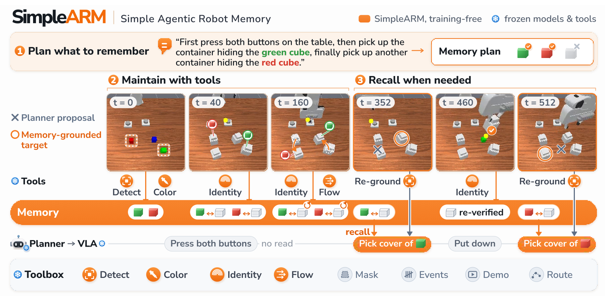
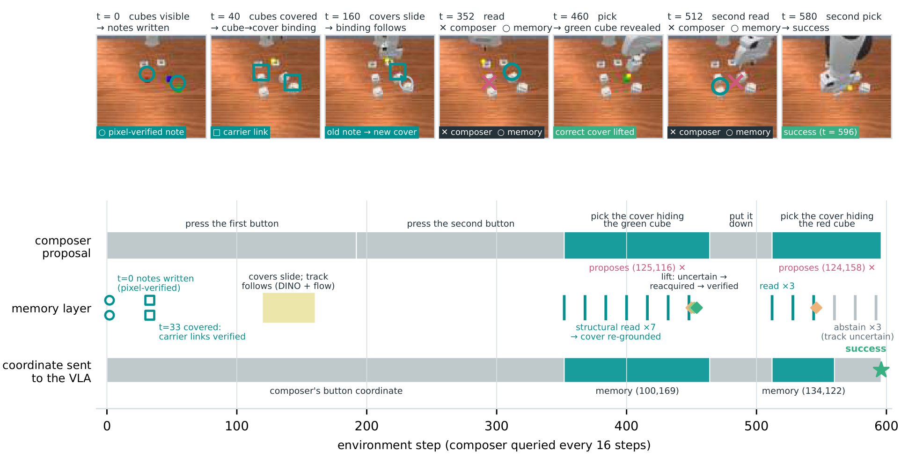

# SimpleARM：记忆写在策略外，读取要有条件

> **简短说明。** Simple Agentic Robot Memory 在冻结的子目标预测器与 VLA 外增加显式状态：语言先提出要记什么，感知工具维护事实，结构化规则只在历史相关子目标中读取，并用当前画面重新定位。RoboMME 16 任务均值 67.17%，但计数组低于 FrameSamp，StopCube 为 0/150。新增记忆层免训练，底座已在 RoboMME 微调；没有真机验证。

核读：[官方 Memory Workshop PDF](https://corl2026-memory.github.io/papers/054.pdf)，32 页全文及附录 A–H，含七组工具轨迹。论文 PDF 保留匿名投稿模板；[Workshop 官方列表](https://corl2026-memory.github.io/papers.html)提供公开作者信息。本文只确认该 Workshop 收录，不由模板推断主会录用。未运行源码。

## ① 问题：有记忆，不代表该在此刻读取

同一画面可能对应不同的历史：哪个方块刚才被拿过、哪个容器藏着绿色方块、左右运动已经完成几轮。这些都不是单帧事实。但把全部记忆一股脑交给策略也会出错：按按钮的当前坐标本来清楚，却可能被一个无关的历史容器位置覆盖。

论文把记忆拆成三个问题：**维护什么变量，什么证据允许更新，当前哪一个动作字段确实需要历史？** 它的控制接口是文本子目标和目标坐标，记忆层修正这些字段，再由冻结的 VLA 执行。它不训练一个新的动作网络，也没有让 LLM 在每次低层动作中自由决定读写。[§1–2](https://corl2026-memory.github.io/papers/054.pdf#page=1)

## ② 思路重建：把身份与位置拆开

[推断] 先看“按两个按钮，再拿起藏着绿色方块的容器”。在按按钮阶段，当前图像足以定位按钮，历史不应干预。到了拿容器阶段，历史决定 **哪个容器**，但它滑动过，所以旧坐标不能直接执行。合理接口是历史提供身份，当前感知提供位置；找不到可靠位置时放弃覆盖原子目标。

按这个逻辑，语言模型适合编译候选 schema，感知负责事实更新，规则负责精准读取。是否有必要让更自由的 agent 决定每次读取，需要实验而非预设。论文的 agent-decided access 消融反而变差，说明“Agentic”不意味着每个环节都越自主越好。

## ③ 方法：从指令编译到受约束的读取

**模型与边界。** 高层是 RoboMME 微调的 Qwen3-VL-4B-Instruct，低层是 π₀.₅-based GroundSG，检查点分别为 1,200 和 79,999。新增记忆使用同一 Qwen 权重、关闭 subgoal adapter 做纯文本规划，不额外加载一个大模型。所有模型和提示在评测中冻结，episode 结束全部记录清空。“免训练”描述新增层，不抹去预训练和 benchmark 微调。[Appendix B.4/D](https://corl2026-memory.github.io/papers/054.pdf#page=12)

**开始时的十次调用。** 状态选择、实体区分、reader program 三个阶段各用三种换行宽度的相同提示做多数投票，另一次提取重复次数，共十次。确定性解码下的换行投票并非三个独立模型。所有新增 LLM 调用都在首个动作前完成；此后基础系统仍会运行自己的高层预测器。编译器在 2,400 episodes 中有 234 次没有得到足够合法读程序，回退为空。

**三个状态仓。** 实体/关系保存身份、角色、容器绑定；进度保存经证据确认的事件次数与阶段；轨迹/过程保存示范中的有序路径和当前索引。指令只提出要估计的变量，不能直接把“已经完成三次”写成事实。

`Mₜ = U(Mₜ₋₁,oₜ,aₜ₋₁;g,d)`，其中 g 是指令，d 是可选示范。每个变量只有在证据门 Aᵢ 接受时才更新，否则保留旧值：`mᵢₜ = Uᵢ(mᵢₜ₋₁,zᵢₜ)` 或 `mᵢₜ = mᵢₜ₋₁`。[Eq.1–2 / Appendix B](https://corl2026-memory.github.io/papers/054.pdf#page=2)

**教学算例：三次往返不是三次闪光。** 若一次左右往返有两个目标到达事件，则三次往返需要六个已确认事件。`cₜ=cₜ₋₁+1[新事件已验证]`：已有 4 个事件时，连续两帧看到同一次闪光仍保持 4；新的第五次到达才加为 5，最后一个到达确认后才能进入停止阶段。论文 SwingXtimes 使用环境的可见红色到达闪光及 RGB 判据，不是从语言模型的“我做完了”计数。这个 benchmark 特定 cue 是工程条件，真机不能假设天然存在。

**工具具体做什么。** Grounding DINO 提候选框，命名颜色像素谓词验证；DINOv2-small 特征提供身份锚点，Lucas–Kanade 光流检查连续性，SAM2.1-tiny 在歧义与恢复时提供 mask。记录有 candidate、verified、uncertain、reacquired 状态；最多扩大搜索三次。write threshold 0.30、身份相似度阈值 0.65；控制 action horizon 16。路径解析器还使用固定相机方向、颜色 cue、事件词和正则表达式，所以当前实例带有 RoboMME 特定词汇与几何约定。

**读取与执行。** 先由冻结预测器得到 û。结构化 query 判断是否有兼容的历史相关字段，检索结果 r；实体字段额外做 `γ=Ground(r,oₜ)`。只有检索和必要的当前定位都成功，才形成修正子目标 ũ。否则 ũ=û；这只表示记忆层弃权，**并不保证原策略随后安全或正确**。[Appendix D，pp.13–15](https://corl2026-memory.github.io/papers/054.pdf#page=13)

图中按按钮时使用原预测器坐标；拿容器时才替换为绑定实体的当前位置。后续抬起容器使跟踪不确定，部分读取弃权。它展示机制实际运行，但单个成功示例不能估计准确率；附录部分演示来自 SAM 不可用的主机或较早配置，不能当作最终完整工具栈的消融。

## ④ 实验：看总分，也看哪些任务更差

**仿真表。** 16 任务×50 episodes×3 policy seeds，共 2,400 次评测；一组冻结权重，三次采样，不是三次独立训练。

| 任务组 | SimpleARM | FrameSamp | 差值 |
| --- | --- | --- | --- |
| Counting | 57.00% | 65.22% | −8.22 点 |
| Permanence | 78.67% | 25.11% | +53.56 点 |
| Reference | 78.50% | 36.33% | +42.17 点 |
| Imitation | 54.50% | 51.39% | +3.11 点 |
| 全体 | 67.17% | 44.51% | +22.66 点 |

SimpleARM 三 seed 均值分别为 67.75、68.00、65.75%，样本标准差 1.23 点。FrameSamp 主表为已发表聚合结果；另做 seed 7 的同 episode 对照：542/800 对 369/800，只有 SimpleARM 成功 254 次、只有 FrameSamp 成功 81 次。两者执行在不同主机，并非同一运行会话的严格复现。[Tables 1/4/6](https://corl2026-memory.github.io/papers/054.pdf#page=3)

**哪些记忆真的影响控制？** 十组消融每组 800 个匹配 episodes、单个 policy seed。路线状态移除使 PatternLock/RouteStick 平均降 68 点；计数移除使 SwingXtimes 降 62 点；示范引用移除使相关三任务降 44.7 点。相同机制在“维护了但没读取”的任务上影响很小，支持收益来自状态到动作的信息流，而不只是工具运行次数增加。

把结构化访问换成每个子目标由 VLM 决定读取，均分从 67.38→55.50%，配对 bootstrap 差值 −11.9 点 [−14.8,−9.0]；在本不需要实体记忆的计数任务上，它大量读取历史，可能覆盖当前坐标。但这是这个实现的访问规则比较，不是所有 LLM 检索器必然较差。[Tables 7–11](https://corl2026-memory.github.io/papers/054.pdf#page=19)

StopCube 的 0/150 暴露了 schema 缺少定时运动状态；InsertPeg 只有 4%，因为“哪一端、从哪侧插入”等动作方式未表达。RouteStick 53.3% 已接近该冻结低层配 oracle 子目标的 55.6%，此时更多记忆可能不是主要瓶颈。

**ID/OOD 表。**

| 变化轴 | 测试 | 证据边界 |
| --- | --- | --- |
| 指令改写 | 8 任务、416 匹配 episodes，下降 17.8 点 | 独立配置敏感性实验；不能直接从最终 67.17% 扣掉 |
| 改检测器 | 8 任务、165 对，下降 5.5 点 | 不是完整视觉 OOD 基准 |
| 路径长度 | PatternLock 长度 1–3 全成功，之后下降；RouteStick 多数更长组更弱 | 观察性切片，长度和几何混杂，小组非单调 |
| 新对象 / 本体 / 真实场景 | 无系统测试 | 没有统一任务外泛化率 |
| 跨 episode 记忆 | 每轮清空 | 不是持续学习或跨会话经验库 |

**真机与成本表。**

| 项目 | 报告 | 限制 |
| --- | --- | --- |
| 真机成功率 | 未测试 | 需要重新验证颜色 cue、视角、跟踪、时间约束 |
| 新增 LLM 成本 | 每 episode 10 次，全部在开始时 | 不等于基础预测器此后不调用模型；未给完整端到端时延 |
| 感知工具耗时 | 平均约 2.02 秒/episode | 不含共享 composer/VLA，不是单步控制时延 |

**内部 verified 不是外部真值。** VideoRepick 全部 150 episodes 的 correct-cube 记录都被内部标为 verified，仍有 33 次失败。ButtonUnmask 27 次失败中有 25 次最终所有载体轨迹都内部 accepted。作者没有保存足够的逐帧真值，无法唯一归因于身份错、定位错或控制错。反过来，工具被调用很多次也不构成因果贡献。[Appendix H](https://corl2026-memory.github.io/papers/054.pdf#page=23)

## ⑤ 攻击与延伸：把“读对了”单独测出来

最脆弱之处是任务特定的事件和语言接口。红环、固定视角、命名颜色、子目标措辞都可帮助记忆，却也可成为隐藏的 benchmark 适配。指令改写造成较大损失，提醒我们 schema 编译和读取都需要鲁棒性测试。

[待验证] 建立同 episode 的 oracle 阶梯：先替换正确状态，再替换正确读取字段，再替换正确当前坐标，最后保留原低层动作。这样能测出瓶颈在写、读、定位还是控制。补做 mark reader、SAM 与 current-view grounding 的单变量消融；已有工具频率统计不能替代这些缺失实验。

[待验证：一周小实验] 在冻结 VLA 上选择一个遮挡交换和一个三次重复任务；首先删除合成红色 cue，用实际接触与物体运动确认事件。固定底座与工具预算，比较原始策略、每步全量注入、结构化访问三组；报告完整成功、无关覆盖次数、漏事件、读错身份与总时延。若仅跑离线日志，就称“记忆路由诊断”，不声称闭环成功。

[推断：对人形/WB-WAM] 高层记忆可维护“哪只手支撑哪件物体、哪个搬运阶段完成”，而当前姿态与接触由实时感知/本体状态决定。高频平衡控制不应等待十次语言投票。这个模块适合阶段级组织；从桌面坐标修正迁到全身动作，需要新的状态契约和事件证据。

## 面试口述版

SimpleARM 最有意思的是，它把“记住”和“在正确时机使用”分开。语言模型在开始时提出候选状态，工具维护实体绑定、计数与路径；只有当前子目标确实缺少历史字段时才读取，身份取自历史，位置重新看当前画面。它不改底层权重，所以容易接到已有策略上，但这个免训练是新增层的属性，底座已经训练过。实验显示有些记忆变量的删除会精准伤害对应任务，不过计数组整体更差、StopCube 全败，也没有真机结果。对我来说可迁移的设计是受证据约束的状态与读取接口，而不是整套 benchmark 特定规则。

## 证据索引与未覆盖项

全文 32 页已核读。主表 Table 1；接口 Appendix B/D；协议 E；匹配对照 F；十组消融 G；失败及七条工具轨迹 H。未将早期/不同主机的演示作为最终配置定量证据；没有补造真机、通用 OOD 或跨会话学习结果。原图版权归作者。
