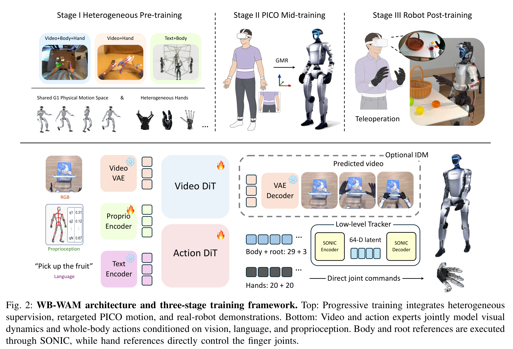

# WB-WAM：异构身体与手部数据，怎样进入一个人形策略？

> **简短说明**：WB-WAM 把有身体、只有手或没有视频的数据，放进同一个有物理含义的全身动作空间。最值得看的是任务对齐的人类中训：四任务中，30 条机器人示范加 PICO 数据达到 73.75%，直接用 100 条机器人示范为 65%；额外人类数据与训练预算必须一起算。五任务 84% 的另一组主实验没有使用 PICO。

**阅读范围**：arXiv:2609.34199v3，2026-10-02，9 页，正文与参考文献已通读；此 PDF 无附录。原文而非代码核验。CoRL 归属沿用源页此前核验的 TAG Workshop Oral；本次 OpenReview 遇到验证码，未独立复核，不能标成主会 Oral。阅读日期：2026-11-17。

**评测先看**：仿真 HumanoidArena 七任务均值 81.9%；真机五任务均值 84%，每项 20 次；严格分层的未见对象、场景、指令 OOD 成功率未报告。核心证据支持异构预训练和目标任务对齐的人类迁移，尚不支持任意任务、任意本体零样本泛化。

## 1. 问题：身体和手的标签不齐，如何仍然学配合？

[原文] 擦桌子时，人形要同时调整站位、躯干和手指。已有大量数据却各缺一块：第一视角操作视频可能只有手部标注；人体动作库有身体，却没有对应视频。如果要求每条样本都同时有身体、双手和视频，预训练可用数据会大幅减少。论文要解决的是**在不完整监督下，学习可传给人形控制器的身体—手部协调动作**。[§I–III，pp.1–4]

输入是第一视角 RGB、语言和机器人本体状态；核心输出是全身物理动作参考，而不是最终电机力矩。成功要求机器人在平衡和可执行约束下完成任务。仅降低关节回归误差不能保证擦到目标区域；重定向成功也不能证明接触动力学可行。

## 2. 思路：为什么把动作语义放在预训练里？

[原文] 视频骨干来自 Wan2.2，训练采用视频/动作双专家；人形部署使用 SONIC 跟踪器，FK 监督借鉴身体几何约束思路。[§II–III、V-A]

[推断] 如果共享空间直接对应“哪些身体关节、哪只手”，每个来源的缺失标签就有明确位置。随后用任务相近的人类示范建立视觉与动作对应，再用机器人数据修正剩余域差。这条设计链由标签缺失、跨形态差异和几何误差三个约束推导而来，不代表作者真实的构思过程。

一个合理替代是直接预测控制器 latent；它可能更容易执行，却会让不同数据源的局部标注难以对齐，也绑定控制器。论文选择物理参考，再在部署端编码进 SONIC。两种方案的等数据、等算力比较仍需专门实验。

## 3. 方法：从人擦桌子，到机器人执行

### 数据谱系与训练阶段

| 阶段 | 数据和规模 | 对齐与训练 | 必须保留的边界 |
|---|---|---|---|
| I 异构预训练 | 九源共 1,880.2 小时；Xperience、EgoDex、HIW-500、Unitree、Humanoid Everyday、GR00T-Teleop、PSI-Real、MotionMillion、BONES-SEED | video-body-hand / video-hand / text-body 按 3:1:1 采样；1 epoch，batch 16 | 采样比例不是数据小时比例 |
| II 人类中训 | PICO 22 小时，13,396 episodes，73 任务；20 Hz | 五点身体追踪；GMR + 约束 IK；MINT 恢复手部；10 epochs | 四项迁移评测的每个任务约 150 条人类示范已包含其中 |
| III 真机适配 | 总库 1,011 episodes、242,668 帧、3.37 小时、八任务组 | 每任务独立策略，50 epochs，加 FK 几何损失 | 每项比较只使用该协议指定示范数，不是全部库；不是一个统一八任务策略 |

[原文] 来源：§III–IV、V-A/E，pp.3–7。VAE 与 UMT5 冻结，视频/动作专家和本体编码器训练；动作专家缩窄并迁移结构权重，输入输出投影随机初始化。

### 动作里的 72 维到底是什么？

每步 `a = [q_body(29), root(3), q_left(20), q_right(20)]`。root 三项是 **roll、pitch、yaw angular velocity**，不是 xyz 平移。物理动作空间是 72D；实现输出头预留到 96D，不能混称。身体/根部参考随后进入冻结 SONIC encoder 的 64D latent，手部直接发送关节指令。[§III-B、V-A]

擦桌子例子中，PICO 追踪到的是人的身体动作；GMR 与约束 IK 先把它转换成 G1 的运动学参考，手部恢复成 Wuji 参考。模型学的是这个共同 schema 中的动作。真机后训练时，FK 在 pelvis frame 比较所选身体 links 的位置和朝向，让关节误差对应到空间几何。

### 一个掩码公式，两个不同的实现含义

Flow matching 用 `yτ = (1−τ)y₀ + τε`，目标速度 `u = ε−y₀`；τ 是噪声时间，视频和动作独立采样。动作目标为 `u_a = M ⊙ (ε−A₀)`，M 标记有效维度。[§III-C]

[原文] 动作 MSE 在**整个轨迹张量**上平均，缺失项的目标速度置零；不能自动解释为“只在有效项上算平均”。[推断·教学算例] 若 A₀=0.4、ε=1.2、τ=0.5，则输入为 0.8、有效速度标签为 0.8。缺失时 M=0，目标变为 0；网络若预测 0.3，这一项仍贡献 0.09/N 的 MSE。完全忽略缺失项则没有这项梯度。两者对缺失率不同的数据源可能产生不同偏置，需要代码和消融验证。

### 推理时，生成模型与控制环如何交接？

[原文] 每次预测 32 步、20 次去噪，执行前 20 步，动作回放 20 Hz。身体/根部以十帧、0.1 秒间隔组成窗口，经 SONIC encoder；跟踪策略 50 Hz，低层发送 500 Hz；手部走直接指令。部署采用仅当前帧的 FastWAM 路径，不要求每次生成未来视频。[§V-A、Fig.5]

**因此 500 Hz 不是 WAM 推理速度。** Fig.5 的模型频率约 0.7 Hz 与动作回放节奏也不能直接拼成已证明的传感器到电机延迟保证，论文未给完整实时延迟分布。

## 4. 证据：三组实验必须分开看

### 仿真证据表

| 协议 | 任务结果 | 比较与预算边界 |
|---|---|---|
| HumanoidArena，in-GMT；示范/执行均为 SONIC | Football 70.0；DoubleDesk 65.0；P&PBox 86.7；OpenDoor 98.3；SitSofa 95.0；Boxing 81.7；VisNavi 76.7%；平均 81.9% | Table I，p.6；每项最强 baseline 分别 45.0/43.3/75.0/85.0/78.3/76.7/38.3%，不是同一个方法；原表保留误差项，试验数、种子及误差定义不足以统一重算置信区间 |

### ID / OOD 证据表

| 泛化维度 | 已有证据 | 绝对表现与下降 |
|---|---|---|
| 任务对齐人类→机器人 | 四目标任务出现在 PICO 中训中 | 73.75%；不能称未见任务 OOD |
| 对象类别 | 单策略 300 条示范，橙/柠檬/苹果分别 15/20、17/20、16/20 | 三种训练内类别，不能据此推出未见类别泛化 |
| 外观变化 | 新购物车外观的定性演示 Fig.7 | 未分层报告次数，ID→OOD 下降不可算 |
| 新场景、语言组合、跨本体、长期记忆 | 未报告匹配的独立测试 | 未报告 |

### 真机证据表：Table II，p.6

G1 + Wuji + D455；各方法约 100 条机器人示范/任务、相同执行接口。WB-WAM 从 Stage I 初始化，**这组没有 Stage II PICO**。每项 20 次；下列区间为阅读者根据计数计算的 Wilson 95%，不是原文报告值，也不是方法差异显著性检验。

| 任务 | WB-WAM 成功/次数 | SR · Wilson 95% | OpenWAM 同协议 |
|---|---|---|---|
| 擦桌 | 15/20 | {{ci:15/20}} | 18/20 |
| 拉帘 | 13/20 | {{ci:13/20}} | 8/20 |
| 铺床 | 18/20 | {{ci:18/20}} | 17/20 |
| 枕头 | 20/20 | {{ci:20/20}} | 20/20 |
| 叠衣 | 18/20 | {{ci:18/20}} | 17/20 |

五任务等权平均：WB-WAM 84%，OpenWAM 80%；不能说每项都更强。ACT/π0.5/GR00T N1.6/Fast-WAM/DiT4DiT 的均值分别 20/52/42/6/31%。不同任务的合计不当作同一成功概率的 100 次重复试验。

**PICO 迁移另看 Table III，p.7**：四任务每项 20 次，30 条机器人直接训练为 48.75%；100 条为 65%；PICO + 30 条为 73.75%。固定 30 条机器人时提高 25 个百分点；相对 100 条提高 8.75 点，同时机器人示范减少 70%。代价是额外 22 小时人类数据、中训计算及目标任务覆盖，无法推出等总预算优势。

| 主张 | 机制 | 对应证据 | 仍未排除 |
|---|---|---|---|
| 人类数据帮助少样本迁移 | 任务对齐中训 | Table III，同机器人数量对照 | 任务覆盖、额外更新步数与人类模态各自贡献 |
| 全身预训练有用 | 物理共享动作与几何约束 | Table I–II 与文中消融 | 各来源、骨干规模、执行器的完全解耦归因 |
| 身体/手协同可执行 | 分路接口 + SONIC | 五项真机任务 | 新接触、摩擦、负载、长时序组合 |

## 5. 反例与一周能做的实验

[推断] 最强贡献是把身体—手部监督与缺失标签纳入预训练，并给出真实机器人上的迁移证据。脆弱点是运动学对齐可能在接触阶段失效：同一擦拭轨迹换成高摩擦桌布，参考姿态仍相似，实际受力和平衡却可能完全不同。

[猜测/待验证] 最值得做的是**固定 30 条机器人示范和更新步数，比较同任务 PICO、任务不重合 PICO、打乱时序 PICO、无 PICO**。指标同时记录任务 SR、接触滑移、跟踪误差和失败类型。如果收益只出现在同任务组，就反驳“普遍人类动作先验足以解释全部增益”；如果打乱时序也相近，则需排查额外训练或静态视觉覆盖的作用。

一周计划：第 1 天核对公开代码/权重及数据访问条件；第 2 天检查时间戳、坐标、缺失率和掩码梯度；第 3–4 天在现成 checkpoint 上跑小规模对照；第 5 天用相同 tracker 仿真回放；第 6–7 天若有 G1/Wuji 与安全场地，再做匹配真机试验。资源不足则只交付数据/离线接口审计，不声称复现真机 SR。公开权重、GPU 显存与训练脚本是否齐全本次未核验；从头复现 1,880 小时预训练不在一周计划内。

## 面试口述版

WB-WAM 处理的是人形数据不齐的问题：有的视频能看见手，但没有全身标签；有的动作库有身体，却没有视频。它先用 72 维物理动作空间，把身体、根部和两只手放到共同坐标中，用各来源能提供的监督做视频—动作预训练，再用任务相近的人类数据中训，最后用机器人数据和 FK 几何约束适配。部署时身体通过 SONIC 跟踪，手部直接执行。

最有价值的结果是同样 30 条机器人示范，人类中训将四任务均值从 48.75% 提到 73.75%，还超过直接用 100 条机器人数据的 65%。但它额外用了包含这些任务的人类示范，不能说总数据更少或目标任务零样本。另一个五任务 84% 的主结果没有用 PICO。下一步我会固定预算，分开测任务对齐、人类模态和控制器对误差的容忍度。

## 来源与修订

- [WB-WAM v3 原文](https://arxiv.org/abs/2609.34199v3)：§III–V、Tables I–IV、Figures 2–7。
- [TAG OpenReview 条目](https://openreview.net/forum?id=smsDWzIc0Q)：本次访问遇验证码，会议归属参考源 Notion 的既有核验，不扩大为主会录用。
- 本页公式算例、Wilson 区间、反例和实验计划均为阅读者补充；未检视官方代码。2026-11-17 初稿。
