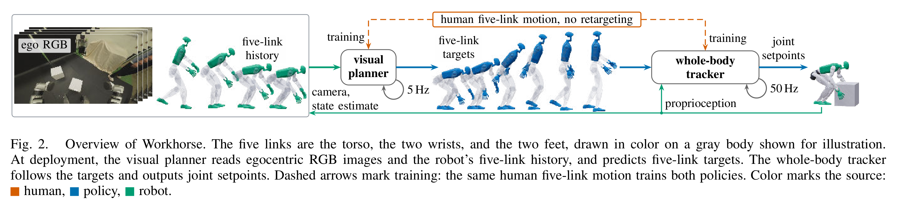

# Workhorse：人类五点运动，怎样驱动能受扰动的人形？

> **简短说明**：Workhorse 从躯干、双手腕和双脚五点人类示范学习视觉规划，再让 RL 控制器完成跟踪。关键是显式训练“计划与当前身体状态不一致”的情况。77% 与 64% 是仿真三箱任务的成功率；真机搬箱、接箱和拖行李属于能力展示，没有报告成组成功次数。

**阅读范围**：Contact-Rich Loco-Manipulation Workshop Spotlight；公开 PDF 9 页，含 pp.6–9 附录，已通读；未审代码。阅读日期 2026-11-17。

**评测先看**：仿真三箱任务无推力 77/100，40 N 推力 64/100；跨到 H2 需重训规划器和控制器，无推力 83/100。真机 G1 展示搬运、接箱和 14 kg 行李操作，未给 SR；不能把机器人更换说成不重训零样本迁移。

## 1. 问题：参考动作可行，执行中的身体却会落后

[原文] 接住箱子或拉重行李时，负载和碰撞会使机器人偏离原来的参考轨迹。人类示范能给任务策略，但复制全部关节太受本体约束；只提供手目标又丢掉躯干和足部协调。本文研究五点位姿的视觉规划接口，以及在偏差不断积累时仍能执行的控制器。[§I–III]

具体任务是依次把三个箱子搬到目标区域。策略从胸前 RGB、五点历史和身体状态预测未来五点轨迹；跟踪器负责 29 个关节。仿真成功要求 120 秒内完成三个箱子且不跌倒。由此“更听从计划”和“更不容易摔倒”不一定同向，实验必须分别记录。

## 2. 思路：给控制器足够自由，也让规划器见过偏差

[原文] 五点链接经过固定刚体变换映射，不做人体轨迹缩放或整段动作重定向；控制器延续 BeyondMimic 风格，附录包含 SuperMimic 的学习动力学训练路径。[§III、App.C]

[推断] 五点比关节角更接近任务空间，比单纯双手目标多了姿态和支撑信息。如果控制器只有干净轨迹训练，它可能把“落后一点”视作必须急追的错误。让控制器训练时看到逐渐漂移的指令，让规划器看到身体已偏离计划的历史，可针对这一闭环失配。替代是加强在线 MPC/重规划；可能提高约束可解释性，但带来计算和模型依赖，本文未做等预算全面比较。

## 3. 方法：一个箱子怎样从人类示范变成 G1 动作？

### 数据与对齐

| 来源 | 规模/设备 | 用途和代价 |
|---|---|---|
| 人类五点动作 | 一人、一房间；箱子 2.2 h，行李 1.2 h，接箱 13 min | 五 Vive trackers + 四基站，约 5×5 m 区域，60 Hz |
| 胸前视觉 | DJI 相机 30 fps | 用拍手做流同步，报告误差约 5.5 ms |
| 人体外观替换 | SAM3、LaMa、MoGe2 + MuJoCo 渲染 | 将人替换成目标机器人；也引入视觉处理成本与合成误差 |
| 仿真规划器评测配方 | 重建房间的额外数据约占 15% | 仿真结果并非完全不加针对性数据 |
| 跟踪器训练 | 箱子以腕部弹簧扰动近似，最大约 40 N；行李使用完整物体仿真 | 简化力模型与真实接触存在差异 |

[原文] §III、App.A–D。所谓直接五点映射仍包含坐标校准；IK 用于奖励/初始化、图像机器人姿态及采集可达性预览，不能把本文概括为“全流程没有 IK”。

### 五点参考的空间与时间

刚体接口为 `world_T_link = world_T_tracker · tracker_T_alignment · inverse(link_T_alignment)`。每一点用位置 3 维、旋转 6 维，五点共 45D，不是 45 个关节。[Eq.1]

视觉规划器 5 Hz：读四张 RGB（间隔 0.24 s）、九帧五点历史（间隔 0.12 s）、投影重力和躯干高度；从零训练的 ResNet18 + flow DiT 输出 `58×45`，对应 50 Hz 下 1.16 秒轨迹，推理 10 个 Euler steps。跟踪器 50 Hz，观察未来 0.2 秒内六个参考点及本体状态，产生 29 关节位置目标。[§III、App.C]

躯干与手腕使用全局目标，足部主要相对躯干跟踪，从而留出平衡调整的余地。部署规划器在笔记本，跟踪器在机载；不需要外部动作捕捉反馈，但需要机器人本体感知。

### 两处增强修补同一个闭环缺口

跟踪器训练时，命令漂移累积到最多约 10 cm、10°，在 0.2–1 秒的重规划间隔重置；奖励针对漂移后的命令，因为控制器拿不到隐藏的“正确意图”。规划器训练则把输入历史扰动、目标保留干净，并对图像做一致的几何/遮挡增强。[§III-C]

[推断·教学算例] 假设箱子使手腕落后 5 cm。控制器需要在不失衡的条件下追当前收到的目标；下一次规划器看到已经落后的身体，应重新给可达的未来，而不是继续假定身体完美执行。两者职责不同：一个在两次重规划之间稳住，另一个重写后续参考。

推理给轨迹打时间戳，跳过过期点，变换到最新躯干坐标，并用 real-time chunk inpainting 处理重叠。不能把这个重叠机制与 Long-WAM 的纯异步偏移拼成同一种实现。[§III-D]

## 4. 证据：高成功率的代价可能是更多摔倒

### 仿真证据表：三箱任务

所有条目每条件 100 episodes；有扰动组每 5–10 秒随机方向施加 40 N、持续 1 秒。光照、质量、摩擦固定，主要改变初始位姿与箱子布置。[App.D、Table II，p.8]

| 配置 | 无推力：成功/跌倒 | 有推力：成功/跌倒 | 能解释什么 |
|---|---|---|---|
| 完整 Workhorse | 77/100，1/100 | 64/100，15/100 | 基准表现；成功和安全需分开 |
| 关节命令接口 | 54/100，1/100 | 42/100，4/100 | 五点任务成功更高，但受推时跌倒也更多 |
| link-local 接口 | 5/100，77/100 | 4/100，91/100 | 坐标与全局任务约束重要 |
| 去掉重力与高度 | 1/100，97/100 | 1/100，99/100 | 两项一起移除，不能归因为只有重力 |
| 去掉规划器增强 | 20/100，79/100 | 0/100，95/100 | 移除多种增强，不能单独证明漂移增强因果 |
| 去掉命令增强 | 76/100，4/100 | 52/100，23/100 | 扰动下差异更明显 |

完整方法无推力 77% 的 Wilson 95% 为 {{ci:77/100}}；有推力 64% 为 {{ci:64/100}}。区间为阅读者计算，不能据重叠与否代替正确的配对/多重比较检验。

### ID / OOD 证据表

| 变化维度 | ID/变化后表现 | 降幅与边界 |
|---|---|---|
| 外力扰动 | 无推力 77% → 推力 64% | 同任务下降 13 点，保留 83.1%；训练含扰动，因此称扰动鲁棒性，不称完全未见动力学 |
| G1→H2 | G1 77%，H2 83%，各 100 次无推力 | H2 重训规划器和控制器、重渲染外观；不是零样本本体 OOD；不可当成同一模型保留率 |
| 光照、摩擦、负载外推 | 仿真主评测固定这些变量 | 未报告匹配的分层 OOD |
| 新语言/多任务组合 | 未给完整分层评测 | 未报告 |

### 真机证据表

| G1 展示 | 观察到的能力 | 数量与不能推出的结论 |
|---|---|---|
| 搬运三箱 | 两箱用手、另一箱可踢动 | 未给完整试验数/SR |
| 接抛来的箱子 | 展示约 0.56 s 飞行时间的接取 | 不是 0.56 s 端到端推理延迟；未给重复成功次数 |
| 行李操作 | 14 kg 行李、0.39 m 台阶/跳跃等 | 演示能力与恢复片段；未给成组成功率 |

[原文] §IV、Figures 3–4、附录。没有次数，不能计算真机 Wilson 区间；77%/64% 不可移植到这张表。

| 主张 | 机制/证据 | 未排除的解释 |
|---|---|---|
| 五点接口适合任务执行 | 同协议优于关节命令 SR | 更多跌倒意味着可能存在保守性差异 |
| 闭环失配增强有帮助 | 去增强的仿真消融 | 规划增强各组成贡献尚未分离 |
| 同一人类数据能用于不同机器人 | H2 重训后成功演示与仿真 | 重新训练成本、体型渲染与任务适配成本 |

## 5. 反例与一周实验

[推断] 贡献在于把人的五点任务参考与受扰动控制结合。反例是持续高载荷或极端摩擦：五点目标在几何上可达，控制器可能为了追任务目标不断增加跌倒风险。已有受推下 15/100 与关节接口 4/100 的跌倒差距，值得比平均 SR 更优先分析。

[猜测/待验证] 固定规划器与演示数据，扫描控制器跟踪权重/力扰动幅度，绘制任务 SR 与跌倒率的共同变化；另做“只漂移增强”“只视觉增强”“全部增强”“无增强”。若成功增益完全来自更冒险的控制，则同跌倒预算下优势会消失；这是可反驳原机制强解释的测试。

一周计划：前两天核对公开代码/权重、五点坐标及校准；第 3–4 天在已有仿真房间固定 seed 跑小样本对照；第 5 天人工标注跟踪与摔倒类型；后两天做配对复测和时间戳审计。有现成 G1 才做低载真机迁移；无平台则止于仿真。全套 Vive 基站、重建房间与重新训练 H2 不视为免费依赖。

## 面试口述版

Workhorse 从人的躯干、双腕和双脚五点示范中学习任务，再让机器人自己的 RL 控制器把这些目标变成关节运动。它的重点是执行时身体常常会落后于计划：控制器训练要见过偏移的命令，视觉规划器也要见过不完美执行的历史，后续参考才不会持续脱离机器人实际状态。

仿真三箱任务里，无推力成功率 77%，受推是 64%；这些数字不能说成真机结果。真机展示了搬箱、接箱、拖重行李，但没有重复试验成功率。还有一个值得注意的结果：五点接口受推时比关节接口成功率更高，跌倒也更多。所以我最想做的是在相同跌倒预算下比较接口，看看收益来自更好的任务表达，还是更激进地追目标。

## 来源与修订

- [官方 Workshop PDF](https://contact-rich-loco-manipulation.github.io/papers/30-workhorse.pdf)：§III–IV、App.A–D，尤其 Table II p.8。
- [官方 Workshop 议程](https://contact-rich-loco-manipulation.github.io/program/index.html)：Spotlight 身份。
- 算例、Wilson 区间与实验设计为阅读者补充；2026-11-17 初稿。
